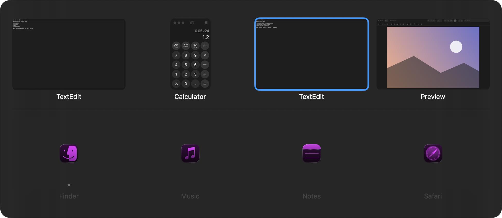
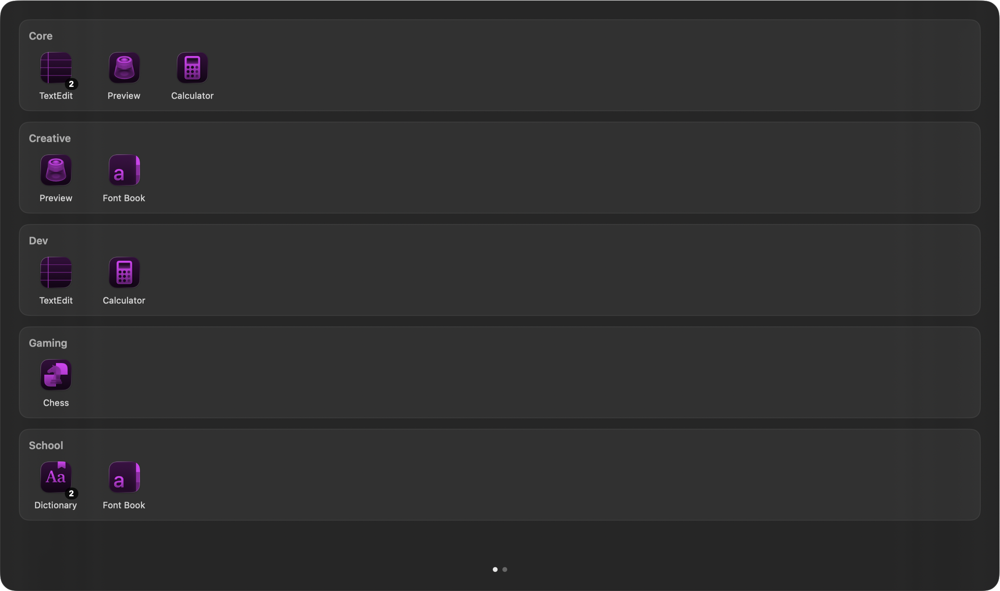
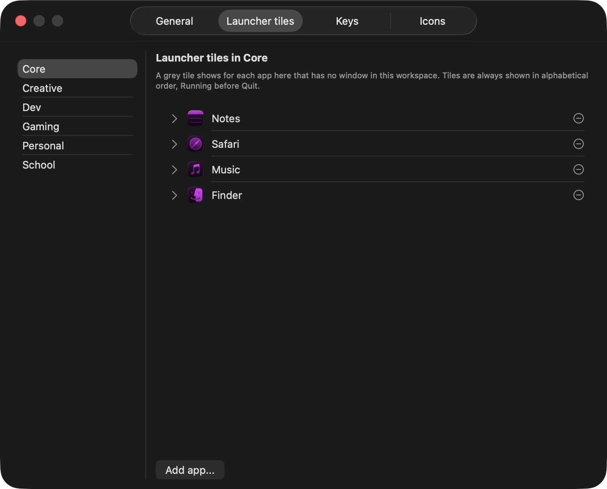

# AeroSwitcher

**Workspaces for macOS, with a Cmd+Tab that only shows the workspace you're in.**

AeroSwitcher gives your Mac a few named workspaces (School, Music, Games, whatever you like). Each window belongs to one of them, and only the windows of the workspace you're in are on screen. Option plus a key jumps between workspaces, and Cmd+Tab only shows the windows of the current one, with real window pictures instead of app icons.

It used to be a companion app for the [AeroSpace](https://github.com/nikitabobko/AeroSpace) window manager. Since version 1.0 it does the window managing itself, so it's one app and nothing else to install.



*The panel shows real window pictures for the workspace you're in. The grey row at the bottom is apps you've assigned to this workspace but haven't opened yet. (Made with dummy windows. The icons look purple because the screenshot's Mac uses macOS's tinted icon style.)*

## Features

- **Workspaces.** Option+key switches workspace, Option+Shift+key sends the window you're in to another one. App rules send an app's new windows to its workspace by themselves (Chrome to School, Spotify to Music).
- **Workspace-scoped Cmd+Tab.** Real window thumbnails, one card per window (not per app), in most-recently-used order.
- **Full screen windows without the full screen animation.** New windows fill the screen, and Option+F flips a window between that and a smaller centered size. Both can be switched off.
- **Launcher tiles.** Apps you've assigned to a workspace but haven't opened yet show up as grey tiles, so you can launch them straight from the switcher.
- **Cmd+\` overview.** A read-only view of every workspace and what's open in it.
- **Left-hand keyboard controls.** Navigate the panel without leaving the Cmd key. All keys are configurable.
- **Settings window.** Workspaces and app rules, launcher tiles, keys (press a key to record it) and custom icons, without editing a file. Changes apply instantly.
- **One menu bar icon.** Shows the workspace you're in. Its menu switches workspaces, brings back every window if one ever goes missing, and opens the settings.
- **Lock icon when keys are blocked.** While a password field is open somewhere, macOS blocks shortcuts for every app. A small lock in the bottom left corner shows when that happens; hover over it to see which app.
- **Never loses a window.** Hidden windows are moved to the bottom right corner of the screen, and where each one was is written to a file first. Quitting AeroSwitcher puts every window back, and so does the next launch after a crash.

## What it looks like

**The Cmd+\` overview** lists every workspace with the apps open in it. It's for looking only, nothing in it is clickable.



**The settings window** edits your workspaces, launcher tiles, keys and icons without opening a file. Changes apply at once.



## Requirements

- macOS 14 (Sonoma) or newer, on an Apple silicon or an Intel Mac (one app runs on both)
- Not at the same time as another window manager like AeroSpace (AeroSwitcher pauses while AeroSpace runs)

## Install

**1. Download** the `AeroSwitcher` zip from the [latest release](https://github.com/remitoshniwal/aeroswitcher/releases/latest), double-click it to unzip, and drag **AeroSwitcher** into your **Applications** folder.

**2. Open it.** The first time, macOS says it can't check the app for malicious software, because AeroSwitcher isn't signed by a paid Apple Developer account. Click **Done** (not Move to Trash), then go to **System Settings > Privacy & Security**, scroll down to the message about AeroSwitcher and click **Open Anyway**. You only do this once.

**3. Grant two permissions** in **System Settings > Privacy & Security**:
- **Accessibility**, so it can catch Cmd+Tab and the Option keys, and move windows
- **Screen Recording**, for the window thumbnails

AeroSwitcher opens a Setup window that shows what's missing, with a button for each. Quit and reopen AeroSwitcher after granting them (Setup has a Restart button).

**4. Try it.** You start with four workspaces, Main, Work, Personal and Extra, on **Option+1** to **Option+4**. The menu bar shows the one you're in. Rename them, add more and set up app rules in **Settings > Workspaces**.

**5. Optional: start it at login.** Tick **Launch at login** in its menu bar menu.

Coming from AeroSpace? Quit AeroSpace and remove it from **System Settings > General > Login Items** first. On its first launch AeroSwitcher copies your workspaces, their keys and your app rules from `~/.aerospace.toml` (it only reads that file, never changes it).

The [installation guide](docs/AeroSwitcher_Installation_Guide.md) walks through all of it step by step, and covers building it yourself.

## Using it

| Keys | What it does |
|---|---|
| **Option+key** | Go to that workspace (keys are set per workspace, Option+1 to Option+4 at first) |
| **Option+Shift+key** | Send the window you're in to that workspace |
| **Option+F** | Flip the window between filling the screen and a smaller centered size |
| **Cmd+Tab** | Open the switcher. Keep holding Cmd and press Tab to move along, release Cmd to switch |
| **Cmd+Shift+Tab** | Same, but moving backwards |
| **Cmd+\`** | Overview of all workspaces (look only, nothing to click) |

While the switcher is open:

| Key | What it does |
|---|---|
| **D** / **A** | Next / previous window |
| **S** / **W** | Move down to the grey launcher tiles / back up to windows |
| **Q** / **E** | Previous / next page, when there are too many windows for one page |
| **F** | Switch now (same as releasing Cmd) |
| **Escape** | Cancel |

Clicking an app in the Dock whose window is in another workspace takes you to that workspace.

## Configuration

Everything is in `~/Library/Application Support/AeroSwitcher/config.json`, created on first launch. Use **Settings...** in the menu bar menu, or edit the file by hand, to:

- add, rename and reorder workspaces and pick their Option keys
- send apps to a workspace (right-click an app in Settings > Workspaces to move it)
- change the keys used inside the panel
- set up the grey launcher tiles for each workspace
- give apps custom icons

Changes from the settings window apply at once, and hand edits as soon as you save the file, no restart needed. The settings window only changes the part you touched, so hand edits are never lost. If something in the file is wrong, a small window says what. The [documentation](docs/AeroSwitcher_Documentation.md) has the full format and examples.

## If something doesn't work

- **A window is missing:** menu bar menu > **Bring Back All Windows** puts every window on screen in the workspace you're in.
- **The menu bar shows a warning triangle:** the window manager is paused. The menu says why (no Accessibility permission, no workspaces, AeroSpace running), and so does the Setup window.
- **A lock in the bottom left corner:** an app has a password field open, and macOS blocks shortcuts until it closes. Hover over the lock to see which app.
- **Cmd+Tab still opens the normal macOS switcher:** Accessibility is missing. Open the Setup window (menu bar menu, **Permissions**).
- **The panel opens but the cards are blank:** Screen Recording is missing. Same window. Screen Recording sometimes only works after AeroSwitcher is restarted, and Setup has a button for that.
- **Cmd+Tab does nothing at all and the log says "did not answer":** macOS's screenshot service is stuck, not AeroSwitcher. It can happen after another user was logged in on the Mac. Log out any other accounts, and if that doesn't help, restart the Mac.
- **A grey tile doesn't open its app:** the tile's **Open name** in **Settings > Launcher tiles** has to be the app's name as macOS knows it. The alert that appears says what macOS answered. If the tile seems to do nothing and no alert appears (Roblox Studio does this), use the full path instead, for example `/Applications/RobloxStudio.app`.
- **Anything else:** the log has the details. **Settings > General > Show log**, or `~/Library/Logs/AeroSwitcher/AeroSwitcher.log`. When you report a problem, paste the first lines of it too, they say which version you run.

## Known limitations

- **Not signed by Apple.** macOS asks you to confirm it once with Open Anyway (install step 2).
- **No tiling.** Windows aren't arranged side by side. Each workspace is a stack of windows that fill the screen (or don't, your choice).
- **One screen at a time.** With a second display, hidden windows are parked on the rightmost one; workspaces aren't per display.
- **Some apps' windows aren't seen.** FL Studio's window isn't recognized as a normal window, so it never appears as a thumbnail. It can still be a launcher tile.
- **Thumbnails are snapshots, not live video.** They're taken fresh each time the panel opens. Live previews were tried and dropped because DRM-protected apps like Spotify can't be captured that way.

## Building it yourself

You need Xcode Command Line Tools (`xcode-select --install`).

```bash
git clone https://github.com/remitoshniwal/aeroswitcher.git
cd aeroswitcher
./build.sh
mv AeroSwitcher.app /Applications/
open /Applications/AeroSwitcher.app
```

An app you build yourself opens without the Open Anyway step. Without a code signing certificate `build.sh` signs the app ad hoc and says so, and then macOS asks for the permissions again after every rebuild. To keep them across rebuilds, create a certificate once: **Keychain Access > Certificate Assistant > Create a Certificate...**, Name `AeroSwitcherCodeSign` (exactly this), Identity Type **Self Signed Root**, Certificate Type **Code Signing**.

```bash
./build.sh                                     # build AeroSwitcher.app in this folder (Apple silicon and Intel, about two minutes the first time)
ARCHS=arm64 ./build.sh                         # same, only for an Apple silicon Mac, quicker for everyday testing
pkill AeroSwitcher                             # stop the running copy (or Quit in its menu); every hidden window comes back first
AeroSwitcher.app/Contents/MacOS/AeroSwitcher   # run it from Terminal to see its log output live
tail -f ~/Library/Logs/AeroSwitcher/AeroSwitcher.log   # or follow the log file of a normally opened copy
```

`build.sh` writes the build number and commit into the app (`Version: 1.0.0 (build 120, a1b2c3d)` at the end of its output); the version itself is the one line in `Info.plist` you edit by hand. The build prints one expected warning about `fullPath(forApplication:)` being deprecated. It's intentional, and the [documentation](docs/AeroSwitcher_Documentation.md) explains why.

## Project structure

```
aeroswitcher/
├── Package.swift                    Swift package definition (macOS 14+)
├── Info.plist                       App settings (no Dock icon, version, icon name)
├── AppIcon.icns                     The app icon (made by make-icon.swift)
├── make-icon.swift                  Redraws AppIcon.icns, only needed to change the icon
├── build.sh                         Builds, wraps into AeroSwitcher.app, signs
├── KnownApps/                       Special handling for a few apps (Steam, Minecraft, ...)
├── Sources/AeroSwitcher/
│   ├── main.swift                   Start-up: load order and launching the app
│   ├── Logging.swift                The log file (logInfo, logWarn, logError, logDebug)
│   ├── WorkspaceManager.swift       The window manager: workspaces, hiding and showing windows
│   ├── WindowTracker.swift          The live list of every window, through Accessibility
│   ├── WindowDetection.swift        Real window, dialog or popup?
│   ├── WindowSizing.swift           Screen sizes, filling the screen, the smaller size
│   ├── AccessibilityHelpers.swift   Talking to other apps' windows
│   ├── WindowList.swift             The window list Cmd+Tab, the overview and the menu read
│   ├── ThumbnailCapture.swift       Window screenshots (ScreenCaptureKit)
│   ├── DataModel.swift              Basic types, new-window scripts for Finder and Terminal
│   ├── Config.swift                 config.json, launcher tiles, custom icons, workspaces
│   ├── Views.swift                  The switcher panel and overview (SwiftUI)
│   ├── MRUTracking.swift            Most-recently-used order
│   ├── WindowController.swift       Paging, selection, showing the panel, switching
│   ├── Keybinds.swift               Key names to key codes
│   ├── HotkeyInterception.swift     Catching Cmd+Tab and the Option keys before macOS does
│   ├── MenuBar.swift                The menu bar icon and its menu
│   ├── SettingsWindow.swift         The settings window
│   └── SetupHelp.swift              Setup checks and the Setup window
└── docs/
    ├── AeroSwitcher_Documentation.md      How everything works, config reference
    └── AeroSwitcher_Installation_Guide.md Full setup, step by step
```

## Credits

The window managing is adapted from [AeroSpace](https://github.com/nikitabobko/AeroSpace) by Nikita Bobko (MIT licence, see [LICENSE-AeroSpace.txt](LICENSE-AeroSpace.txt)): the way windows are hidden in a corner, how windows are found and how focus is followed. AeroSwitcher is a separate project and is not made by or affiliated with the AeroSpace author.

## License

MIT, see [LICENSE](LICENSE). You can use, change and share it, as long as the copyright notice comes along.
