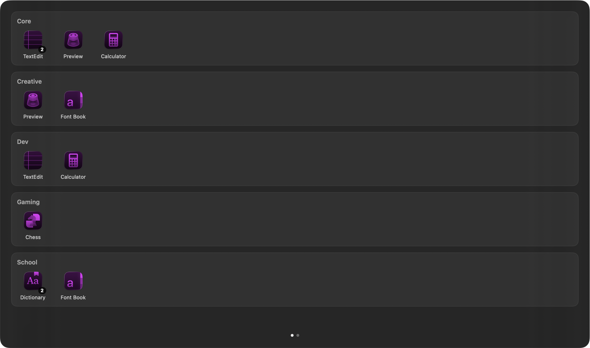
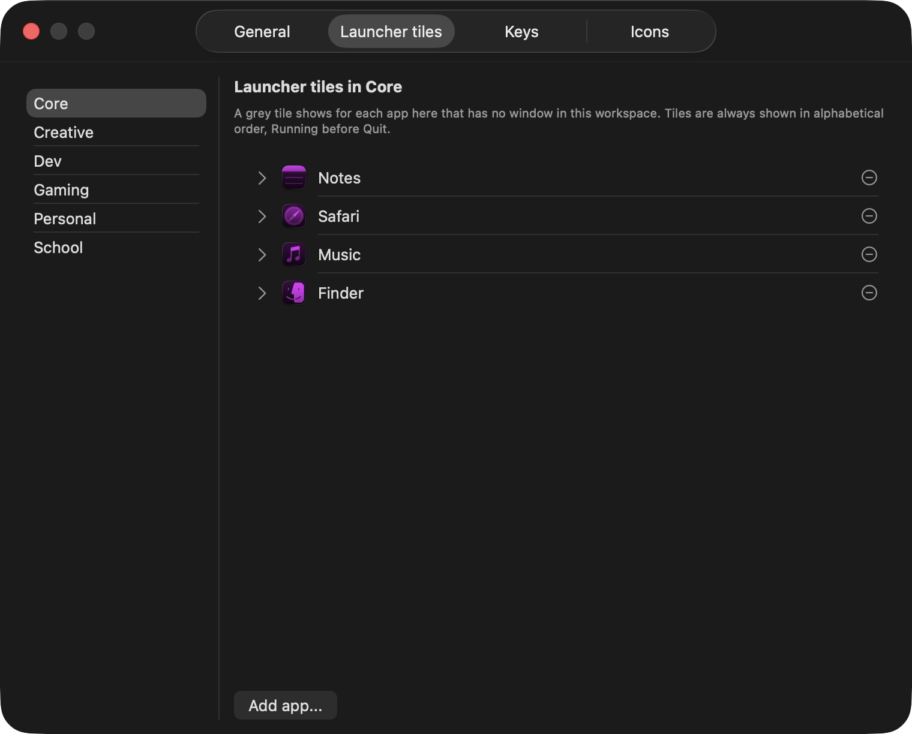

# AeroSwitcher

**Cmd+Tab for [AeroSpace](https://github.com/nikitabobko/AeroSpace) users.** It only shows windows in your current AeroSpace workspace, not every window on your Mac.

If you use AeroSpace workspaces to keep things apart (school in one, music in another, games in a third), the stock macOS Cmd+Tab ignores all of that and shows everything at once. AeroSwitcher replaces it with a switcher that stays inside the workspace you're in.


*The panel shows real window pictures for the workspace you're in. The grey row at the bottom is apps you've assigned to this workspace but haven't opened yet. (Made with dummy windows. The icons look purple because the screenshot's Mac uses macOS's tinted icon style.)*

## Features

- **Workspace-scoped Cmd+Tab.** Real window thumbnails, one card per window (not per app), in most-recently-used order.
- **Launcher tiles.** Apps you've assigned to a workspace but haven't opened yet show up as grey tiles, so you can launch them straight from the switcher.
- **Cmd+\` overview.** A read-only view of every workspace and what's open in it.
- **Left-hand keyboard controls.** Navigate the panel without leaving the Cmd key. All keys are configurable.
- **Settings window.** Launcher tiles (pick apps from a list), keys (press a key to record it), custom icons (one by one, or a whole folder of images named after your apps at once) and the other options, without editing a file. Changes apply instantly.
- **One menu bar icon.** Shows the workspace you're in, with a menu that covers what AeroSpace's own icon does: switch workspaces, enable or disable AeroSpace, reload both configs, open the settings, check permissions, launch at login, quit. It can also hide AeroSpace's icon (by pushing it off screen, since AeroSpace quits if its icon is switched off).
- **Lightweight.** No Dock icon, and nothing else on screen until you press Cmd+Tab. It only talks to AeroSpace through its command line tool and never changes AeroSpace itself.

## What it looks like

**The Cmd+\` overview** lists every workspace with the apps open in it. It's for looking only, nothing in it is clickable.



**The settings window** edits your launcher tiles, keys and icons without opening a file. Changes apply at once.



## Requirements

- macOS 14 (Sonoma) or newer
- [AeroSpace](https://github.com/nikitabobko/AeroSpace), installed with Homebrew
- Xcode Command Line Tools, to build it (`xcode-select --install`)

There's no prebuilt download yet. You build it yourself, which takes a couple of minutes.

## Install

The short version is below. For a step-by-step walkthrough from a blank Mac, see the [installation guide](docs/AeroSwitcher_Installation_Guide.md).

**1. Install AeroSpace** if you haven't already, and give it Accessibility permission when it asks.

```bash
brew install --cask nikitabobko/tap/aerospace
```

**2. Optional, only for an AeroSpace without the `subscribe` command: add this line to your `~/.aerospace.toml`** at the top level, not inside any section. AeroSwitcher keeps its own record of which window you used last from AeroSpace's `subscribe` events, so most people can skip this. The line is only for an AeroSpace too old to have `subscribe`.

```toml
on-focus-changed = ['exec-and-forget /bin/sh -c "mkdir -p /tmp/aerospace-mru && echo $AEROSPACE_WINDOW_ID >> /tmp/aerospace-mru/$(aerospace list-workspaces --focused).log"']
```

**3. Create a code signing certificate (once).** This keeps macOS from asking for permissions again every time you rebuild. Open **Keychain Access**, choose **Keychain Access > Certificate Assistant > Create a Certificate...**, and fill in:
- Name: `AeroSwitcherCodeSign` (exactly this)
- Identity Type: Self Signed Root
- Certificate Type: Code Signing

**4. Build it.**

```bash
git clone https://github.com/remitoshniwal/aeroswitcher.git
cd aeroswitcher
./build.sh
mv AeroSwitcher.app /Applications/
open /Applications/AeroSwitcher.app
```

The first time you open it, macOS may say it can't verify the developer. Right-click the app, choose **Open**, then **Open** again.

**5. Grant two permissions** in **System Settings > Privacy & Security**:
- **Input Monitoring**, so it can catch Cmd+Tab
- **Screen Recording**, for the window thumbnails

If anything is missing, AeroSwitcher opens a Setup window that says what and has a button for each fix. Then quit and reopen AeroSwitcher, hold Cmd and press Tab. You should see your current workspace's windows.

**6. Optional: start it at login.** Open `/Applications/AeroSwitcher.app` and tick **Launch at login** in its menu bar menu.

## First launch: the Setup window

If something AeroSwitcher needs is missing, it opens a **Setup** window on launch. Each line has a tick when it's fine, and a button to fix it when it isn't (open the right System Settings page, start AeroSpace, restart AeroSwitcher). The ticks update by themselves while the window is open. You can open it again any time from the menu bar menu under **Permissions > Setup...** or from **Settings > General**.


## Using it

| Keys | What it does |
|---|---|
| **Cmd+Tab** | Open the switcher. Keep holding Cmd and press Tab to move along, release Cmd to switch |
| **Cmd+Shift+Tab** | Same, but moving backwards |
| **Cmd+\`** | Overview of all workspaces (look only, nothing to click) |

While the switcher is open:

| Key | What it does |
|---|---|
| **D** / **A** | Next / previous window |
| **S** / **W** | Move down to the grey launcher tiles / back up to windows |
| **Q** / **E** | Previous / next page, when there are too many windows for one page |
| **F** | Switch now (same as releasing Cmd) |
| **Escape** | Cancel |

## Configuration

On first launch AeroSwitcher creates `~/Library/Application Support/AeroSwitcher/config.json`. It works without any changes. Use **Settings...** in the menu bar menu, or edit the file by hand, to:

- change the keys used inside the panel
- set up the grey launcher tiles for each workspace
- give apps custom icons
- hide the small status text under launcher tiles

Changes from the settings window apply at once, and hand edits as soon as you save the file, no restart needed. The settings window only changes the part you touched, so hand edits are never lost (its first save tidies the file's layout once, and keeps a `config.json.backup`). If something in it is wrong, a small window says what. The "Config file" section of the [documentation](docs/AeroSwitcher_Documentation.md) has the full format and examples.

## If something doesn't work

- **Cmd+Tab still opens the normal macOS switcher:** Input Monitoring is missing. Open the Setup window (menu bar menu, **Permissions**).
- **The panel opens but the cards are blank:** Screen Recording is missing. Same window. Screen Recording sometimes only works after AeroSwitcher is restarted, and Setup has a button for that.
- **Permissions are asked for again after a rebuild:** the `AeroSwitcherCodeSign` certificate from step 3 is missing or was made with another name.
- **A grey tile doesn't open its app:** the tile's **Open name** in **Settings > Launcher tiles** has to be the app's name as macOS knows it. The alert that appears says what macOS answered.
- **Anything else:** the log has the details. **Settings > General > Show log**, or `~/Library/Logs/AeroSwitcher/AeroSwitcher.log`. When you report a problem, paste the first lines of it too, they say which version you run.

## Optional: the full-screen window setup

The `aerospace/` folder holds the AeroSpace config and three small scripts this project is used with. Together they make every new window fill the screen, and **Alt+F** toggles a window between full screen and a smaller centered size. None of this is needed for AeroSwitcher itself.

If you want to use it, note that the config and `toggle-maximize.sh` contain the full path `/Users/remitoshniwal/...`, because AeroSpace commands don't understand `~`. Replace that with your own home folder path. The [installation guide](docs/AeroSwitcher_Installation_Guide.md) covers where each file goes.

## Known limitations

- **Only works with AeroSpace.** Every window it shows comes from AeroSpace.
- **Apps AeroSpace can't see don't show up as windows.** FL Studio is one: AeroSpace doesn't recognize its window ([AeroSpace discussion #1234](https://github.com/nikitabobko/AeroSpace/discussions/1234)), so it never appears as a thumbnail. It can still be a launcher tile.
- **Not signed by Apple.** It's built and signed on your own Mac, so other people can't simply download and run your copy.
- **Thumbnails are snapshots, not live video.** They're taken fresh each time the panel opens. Live previews were tried and dropped because DRM-protected apps like Spotify can't be captured that way.

## Project structure

```
aeroswitcher/
├── Package.swift                    Swift package definition (macOS 14+)
├── Info.plist                       App settings (no Dock icon, version, icon name)
├── AppIcon.icns                     The app icon (made by make-icon.swift)
├── make-icon.swift                  Redraws AppIcon.icns, only needed to change the icon
├── build.sh                         Builds, wraps into AeroSwitcher.app, signs
├── Sources/AeroSwitcher/
│   ├── main.swift                   Start-up: load order and launching the app
│   ├── Logging.swift                The log file (logInfo, logWarn, logError, logDebug)
│   ├── AeroSpaceBridge.swift        Calls to the aerospace command line tool
│   ├── ThumbnailCapture.swift       Window screenshots (ScreenCaptureKit)
│   ├── DataModel.swift              Basic types, new-window scripts for Finder and Terminal
│   ├── Config.swift                 config.json, launcher tiles, custom icons
│   ├── Views.swift                  The switcher panel and overview (SwiftUI)
│   ├── MRUTracking.swift            Most-recently-used order
│   ├── WindowController.swift       Paging, selection, showing the panel, switching
│   ├── Keybinds.swift               Key names to key codes
│   ├── HotkeyInterception.swift     Catching Cmd+Tab before macOS does
│   ├── MenuBar.swift                The menu bar icon and its menu
│   ├── SettingsWindow.swift         The settings window
│   └── SetupHelp.swift              Setup checks and the Setup window
├── aerospace/                       Optional AeroSpace config and full-screen scripts
├── sync-aerospace.sh                Copies the live AeroSpace files into aerospace/
├── check-drift.js                   Finds apps set up in .aerospace.toml but not config.json, or the reverse
└── docs/
    ├── AeroSwitcher_Documentation.md      How everything works, config reference
    └── AeroSwitcher_Installation_Guide.md Full setup from a blank Mac
```

## Development

```bash
./build.sh                                     # build AeroSwitcher.app in this folder
pkill AeroSwitcher                             # stop the running copy (or Quit in its menu)
AeroSwitcher.app/Contents/MacOS/AeroSwitcher   # run it from Terminal to see its log output live
tail -f ~/Library/Logs/AeroSwitcher/AeroSwitcher.log   # or follow the log file of a normally opened copy
```

`build.sh` writes the build number and commit into the app (`Version: 0.9.0 (build 57, a1b2c3d)` at the end of its output); the version itself is the one line in `Info.plist` you edit by hand. The About panel in the menu shows all of it.

If Cmd+Tab stops responding or thumbnails go blank after a rebuild, check the two permissions first. The build prints one expected warning about `fullPath(forApplication:)` being deprecated. It's intentional, and the [documentation](docs/AeroSwitcher_Documentation.md) explains why.

## Credits

Built on top of [AeroSpace](https://github.com/nikitabobko/AeroSpace) by Nikita Bobko, which does all the actual window management. AeroSwitcher is a separate project and is not made by or affiliated with the AeroSpace author.

## License

MIT, see [LICENSE](LICENSE). You can use, change and share it, as long as the copyright notice comes along.
