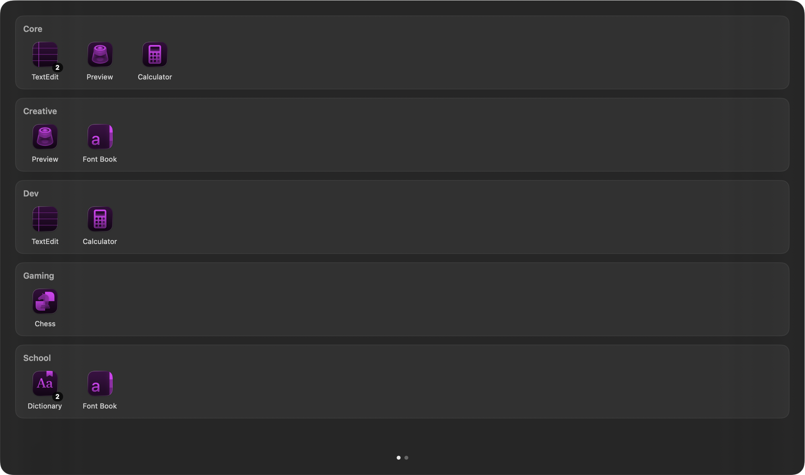
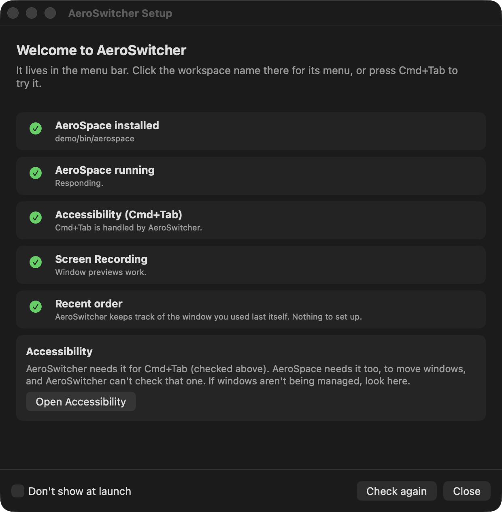
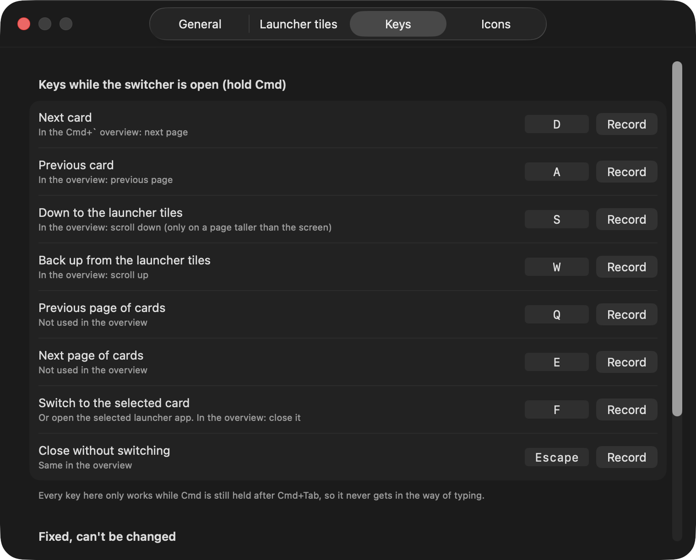
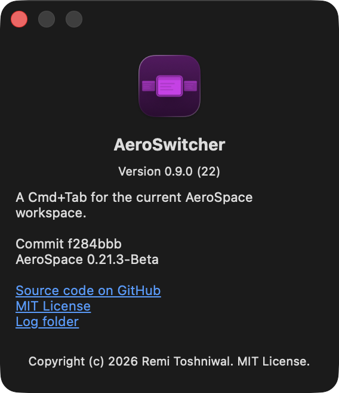

# AeroSwitcher Documentation

## What it is

AeroSwitcher gives macOS named workspaces (for example Core, School, Personal, Creative, Dev, Gaming) and a Cmd+Tab that only shows the workspace you're in. Every window belongs to one workspace, only the current workspace's windows are on screen, Option plus a key switches workspace, and Cmd+Tab shows real pictures of the current workspace's windows instead of every app on the Mac.

Until version 1.0 it was a companion to the AeroSpace window manager, which did the workspaces while AeroSwitcher did Cmd+Tab. Since 1.0 AeroSwitcher manages the windows itself (Phase 14 in the roadmap), with code adapted from AeroSpace (see `LICENSE-AeroSpace.txt`). Some sections below still describe measurements from the AeroSpace days; they say so.

It's a Swift Package Manager project, wrapped into a real `.app` bundle so macOS treats it as a proper application (needed for it to be grantable in System Settings for the permissions it needs, and to run quietly in the background without a Dock icon).

## How it's put together

The app's code lives in `Sources/AeroSwitcher/`, one file per part of the app:

| File | What's in it |
|---|---|
| `main.swift` | Start-up: the order things load in at launch, and starting the app |
| `Logging.swift` | The log file (`logInfo`, `logWarn`, `logError`, `logDebug`) |
| `WorkspaceManager.swift` | The window manager: which window is in which workspace, hiding and showing windows, the Option keys' actions, never losing a window (see "The window manager" below) |
| `WindowTracker.swift` | The live list of every real window on the Mac, read through Accessibility (see "The window list" below) |
| `WindowDetection.swift` | AeroSpace's rules for "is this a real window, a dialog, or just a popup" |
| `WindowSizing.swift` | Screen sizes, making new windows fill the screen, and the smaller size of the toggle |
| `AccessibilityHelpers.swift` | Reading and moving other apps' windows through Accessibility, and the macOS call that gives a window its number |
| `WindowList.swift` | The questions Cmd+Tab, the overview and the menu ask about windows and workspaces, answered from the window manager's copy |
| `ThumbnailCapture.swift` | Taking the window screenshots |
| `DataModel.swift` | The basic types (a thumbnail, a launcher app) and the Finder/Terminal "new window" scripts |
| `Config.swift` | Reading `config.json`, launcher tiles, custom icons, homeless apps, launching apps, the workspaces section, and the safe way the settings window edits `config.json` |
| `Views.swift` | Everything you see: the switcher panel, its cards, and the Cmd+\` overview |
| `MRUTracking.swift` | Recently-used order, and remembering which workspace each app was last in |
| `WindowController.swift` | The panel's brain: paging, selection, showing and hiding it, switching windows |
| `Keybinds.swift` | Turning key names from `config.json` into real key codes, and back (for recording keys) |
| `HotkeyInterception.swift` | Catching Cmd+Tab and the window manager's Option keys before macOS sees them |
| `MenuBar.swift` | The menu bar icon: workspace name, and its menu |
| `SettingsWindow.swift` | The settings window (General, Launcher tiles, Keys, Icons, Workspaces) |
| `SetupHelp.swift` | The setup checks (window manager, Cmd+Tab/Accessibility, Screen Recording) and the Permissions window |

They all build into one app together, so code in one file can use things from another without any extra setup. There's no separate UI framework project, no storyboard, just:

- Cocoa and AppKit for the low level system hooks (intercepting keys, creating a floating window)
- The Accessibility API for seeing, moving and focusing other apps' windows
- SwiftUI for drawing the panel of thumbnails and the settings
- ScreenCaptureKit for taking window screenshots

Files that contain code copied from AeroSpace say so at the top and are listed in `LICENSE-AeroSpace.txt` (MIT).

## The pieces, one at a time

### Intercepting Cmd+Tab

`HotkeyManager` uses a `CGEventTap`, a low level hook that sees every keystroke on the Mac before any app does. When it sees Tab pressed while Cmd is held, it swallows that keystroke (so the real system switcher never sees it and never opens) and tells `SwitcherWindowController` to open instead. When Cmd is released, it tells the controller the session is over. Option plus a workspace key (and Option+Shift, and the toggle key) is handed to the window manager (`handleWindowManagerKey`); every other key with Option goes through untouched, so typing special characters still works.

**Letting go of Cmd before the panel appears.** A quick tap of Cmd+Tab switches to the next window without the panel ever showing, like macOS's own: Cmd is let go while the panel is still loading, and the switch happens the moment loading ends (usually 0.1 to 0.3 s). Since 2026-11-05 that only happens if you let go at most `staleConfirmLimit` (1 second, `WindowController.swift`) before loading ends. When the Mac is busy, loading can take seconds (seen while Minecraft was starting: 2 to 13 s), and switching windows that long after you let go was a surprise. Now such a Cmd+Tab is dropped, logged as `Switcher: Cmd was let go N ms before loading finished, dropped this Cmd+Tab instead of switching late`. Pressing Cmd+Tab again while it is still loading means you want the panel: it opens when ready (logged `Cmd+Tab pressed again while loading`).

This requires the **Accessibility** permission (System Settings > Privacy & Security > Accessibility), because the tap is an active one that swallows the keys. On the author's Mac AeroSwitcher is in the Accessibility list and NOT in the Input Monitoring list, and the tap works (checked 2026-10-26). Apple's developer forums say the same: an active tap needs Accessibility, and Accessibility covers Input Monitoring. Without the permission the tap is not created and Cmd+Tab stays macOS's.

### Getting the window list

Cmd+Tab uses `getWindowsWithFocus()` (`WindowList.swift`): every workspace's windows and the name of the focused workspace, copied from the window manager's memory, so it answers at once. `getWindows(scope:)` gives the focused workspace's windows (or all of them for the Cmd+\` overview), `focusWindow(id:)` switches to a window once you pick one (to its workspace if needed), and `getCurrentWorkspaceName()` gives the workspace you're in, which the launcher tiles need. AeroSwitcher's own windows (settings, Setup, About) are never in the list, so they never show up as an "AeroSwitcher" card.

### The window list

`WindowTracker` (`WindowTracker.swift`) is AeroSwitcher's live list of every real window on the Mac, read straight from macOS through Accessibility, with AeroSpace's rules for telling real windows from popups (`WindowDetection.swift`). Each window carries its app, position and size, title (kept in memory for the Cmd+Tab card, never logged), whether it's minimized or in macOS full screen, and the tracker knows which window has the keyboard focus.

How it keeps up: each watched app (every app with a Dock icon, plus a menu bar app once one of its windows is in front) gets its own background thread, and asks to be told when a window is created, closed, minimized or focused. macOS also says when apps start, quit, are hidden or come to the front, and every mouse button release counts too. Any of these makes the tracker ask the apps again for their windows, which takes a few milliseconds once it has talked to an app once. The tracker itself never moves a window; the window manager does, through the app's own thread (`act`).

Log lines: `WindowTracker: watching N apps, M windows ..., first look took X ms` once at launch, and `WindowTracker: refresh took X ms, no answer yet from: <apps>` (at most once a minute) when an app is slow to answer, usually a frozen app.

If it ever causes trouble, turn it off in Terminal and restart AeroSwitcher: `defaults write com.aeroswitcher.app WindowTrackerOff -bool true` (and `defaults delete com.aeroswitcher.app WindowTrackerOff` to turn it back on). The window manager needs it, and pauses while it is off.

Before 1.0 the tracker ran next to AeroSpace for 9 days (2026-11-05 to 2026-11-14, about 470 comparisons with AeroSpace's own list) and matched it apart from timing (a window that had just opened) and one minimized Obsidian window AeroSpace still listed.

### The window manager

`WorkspaceManager.swift` shows one workspace, hides the others, sorts new windows into workspaces by app, makes every new window fill the screen, and does the Option keys.

**Settings.** Settings > Workspaces (or the `windowManager` section of config.json, see the config file section): the workspaces in order, each with an optional key, the app rules, and the maximize settings. When config.json has no such section yet (a first launch, or an update from before 1.0), one is added at launch (`addWindowManagerSectionIfMissing` in `Config.swift`): four starter workspaces, Main, Work, Personal and Extra on 1 to 4, with F as the toggle key and maximize on (`starterWindowManagerSection`). A section that already exists is never replaced. (Until 2026-11-21 it was copied from `~/.aerospace.toml` when there was one, and Settings had an Import from AeroSpace button; both were removed.)

**Keys:**
- Option + a workspace's key: show that workspace.
- Option + Shift + a workspace's key: send the focused window there (you stay where you are).
- Option + the toggle key (F): the focused window flips between filling the screen and a centered 70% size.

**How a window is hidden.** macOS can't make another app's window invisible, so it is moved into the bottom right corner of the screen with one point of it left on screen ("parked"), AeroSpace's own trick. Showing it again moves it back to where it was.

**What it does on its own:**
- A new window goes to the workspace of the rule whose text is in the app's place on disk (`Google Chrome`, `Steam.app`); if several match, the longest text wins (`RobloxStudio` beats `Roblox`), so the order of rules doesn't matter. No match: to the workspace you are in. A real window (one that can go full screen) is made to fill the screen, a dialog is left alone. If the new window lands in another workspace it is parked right away.
- Clicking an app in the Dock (or a notification) whose window is in another workspace shows that workspace.
- Minimized windows, windows in macOS full screen and windows of a hidden app (Cmd+H) are never parked.

**Never losing a window:**
- Where every parked window was is written to `window-state.json` (next to config.json) before it is moved.
- Quitting AeroSwitcher (menu, `pkill`, Ctrl+C) moves every parked window back first (log: `WorkspaceManager: quitting, moved N of M parked windows back on screen`).
- After a crash or `kill -9`, the next start reads the file and the windows keep their workspaces and their places.
- Menu > **Bring Back All Windows** moves every window into the workspace you are in and on screen, including any left in the corner by something else.
- It pauses (and puts every window back on screen) whenever AeroSpace is running (two window managers would fight), Accessibility is off, the window list is switched off, or there are no workspaces. The menu bar shows a warning symbol and the reason, the Permissions window says what to do (with a Quit AeroSpace button when that's the reason), and the Option keys go through untouched while paused.

**Log lines** start with `WorkspaceManager:` (`Core -> School, 3 shown, 2 parked`, `new windows: ...`, `paused: ...`). Window titles are never logged.

**Known limits:** only tested with one display. Switching to an empty workspace puts AeroSwitcher itself in front (so keys don't go into a hidden window); click any app or press a workspace key to carry on. Windows of an app that macOS reports as hidden (Cmd+H) are never parked, like in AeroSpace; an app started in the background by a script can count as hidden until it first comes to the front, so its windows stay visible in another workspace until then (seen with TextEdit in testing). An app that moves its own window back on screen while parked is parked again at the next update. Windows of an app that answers slowly appear in Cmd+Tab a moment late.

### Taking the screenshots

Each window's thumbnail is a real screenshot, taken fresh every single time you open the switcher. There's no cache and no live video feed, `captureThumbnail` calls `SCScreenshotManager.captureImage`, a one shot snapshot, once per window, and all the windows are captured in parallel (not one after another) to keep things fast.

**Not waiting for slow screenshots (added 2026-11-04).** The panel used to wait for the slowest screenshot before it opened. Most screenshots take 40 to 200 ms, but a window in macOS's own full screen on another desktop (the Minecraft game) took 1.2 to 2.5 seconds just to fail, and a busy Mac makes some normal ones slow too, so Cmd+Tab sometimes took over 2 seconds to open. Now the switcher waits at most `screenshotWaitLimit` (0.25 seconds, `ThumbnailCapture.swift`) after the screenshots start. A window whose screenshot isn't back by then starts as an icon card, and its picture replaces the icon the moment it arrives (`applyLateImage` in `WindowController.swift`), even while the panel is open. If that late screenshot fails, the icon card simply stays. A late picture from an earlier Cmd+Tab is ignored. Lower the 0.25 for an even faster panel with more cards that start as icons, raise it for fewer. The "late" count in the `Switcher:` log line shows how often it happens. Tested 2026-11-05 with the full screen Minecraft game: its screenshot now fails within about 0.1 s and the icon card shows. A late picture that does arrive writes `Switcher: a late screenshot arrived and replaced its icon card` to the normal log (a debug-only line before 2026-11-05). What this does NOT speed up: if AeroSpace itself is slow to answer (seen on a busy Mac, logged as `aerospace ... took longer than 2.0s and was stopped`), the panel still has to wait for its window list, and the log line then shows a big "window lists" time.

**Early start on Cmd press (added 2026-11-04).** Before any screenshot, Cmd+Tab used to spend about 70 ms (up to 220 ms) getting the window lists, mostly macOS's own list for screenshots (40 to 60 ms; AeroSpace's answers take about 20 ms). People press Cmd a moment before Tab, so macOS's list is now asked for the moment Cmd goes down (`prefetchLists` in `WindowController.swift`, called from the event tap in `HotkeyInterception.swift`), and also when a panel closes while Cmd is still held (`prefetchIfCmdHeld`, for switching in bursts: Cmd held, Tab, F, Tab, F, ...). Cmd+Tab uses that answer if it is at most `prefetchMaxAge` (1.5 s) old. AeroSpace is always asked fresh on Tab: fetching AeroSpace's list early too was tried and removed the same day, because a copy taken right as a switch finished sometimes listed only one of the workspace's windows, and Cmd+Tab then showed only the current window. If AeroSpace lists a window that macOS's early list doesn't have (a window that opened in between), macOS is asked again, so no window loses its card. Screenshots are never taken early. AeroSpace answers questions one after another, so Cmd+Tab now asks it only one question first (this workspace's windows, whose lines already carry the workspace name); the every-workspace list starts after that answer and runs during the screenshots, and the workspace name is only asked separately for an empty workspace. Measured: one question alone about 20 ms, three at once about 33 ms.

**One question to AeroSpace (added 2026-11-05).** Cmd+Tab needs this workspace's windows (the cards) and every workspace's windows (for the grey "No window" tiles), and used to ask AeroSpace for them one after the other. Testing with the Minecraft game in macOS full screen showed that right after a slide between the game's own desktop and the normal one, AeroSpace takes 70 to 860 ms per answer instead of about 35 ms, and the second question alone added about half a second. Now Cmd+Tab asks once (`getWindowsWithFocus`, then in `AeroSpaceBridge.swift`, now `WindowList.swift`): every window, each line also saying whether its workspace is focused, so the cards are the windows of the focused workspace and the same answer serves the tiles. In normal use it costs the same (about 25 ms). An empty focused workspace has no "focused" line, so its name is still asked separately. If AeroSpace is too old to know `%{workspace-is-focused}`, AeroSwitcher logs it once and asks the old two questions from then on; any other failure falls back for that one press. The `Switcher:` log line says `AeroSpace asked twice` when the fallback was used. What it does NOT fix: the one remaining answer is still slow right after a full screen slide, that is AeroSpace itself.

**Screenshots started before AeroSpace answers (added 2026-11-04).** While AeroSpace is still answering, Cmd+Tab already starts the screenshots of the windows this workspace had at the last Cmd+Tab (`guessedWindowIDs` in `WindowController.swift`: every workspace's windows from the last Cmd+Tab, filtered by the workspace AeroSpace last reported focus in, kept current by `noteFocusedWorkspace` from the event stream in `main.swift`). The pictures are still taken after you press Tab. Only windows in AeroSpace's real answer get a card: a guessed window that is gone is ignored, a new window gets its screenshot started after the answer (`captureAll`'s `started`, `startCapture` in `ThumbnailCapture.swift`). The log line says `K of N started early`.

**Warm-up at launch (added 2026-11-04).** The first Cmd+Tab after a start used to take 300 to 580 ms (first drawing of the panel about 200 ms, first screenshots slow too). At launch `warmUp()` (`WindowController.swift`, called from `main.swift`) draws the panel once with one made-up card into an image in memory (the window is never shown, the image is thrown away), and, only if Screen Recording is already allowed (look-only `CGPreflightScreenCaptureAccess`, so macOS never shows its permission request because of this), 3 seconds later asks macOS for its window list and takes one 16x16 screenshot of an on-screen window that is thrown away at once. Log: `Warm-up: panel drawn once in memory in N ms` and `Warm-up: screenshot service ready in N ms`. The cost: every Cmd press (Cmd+C, Cmd+V, ...) asks macOS once in the background, thrown away when no Tab follows. Set `prefetchOnCmdPress` to false to switch it off. Also new: each tile's Running/Quit state is worked out once per Cmd+Tab (`launcherRunningStates` in `Config.swift`) instead of again inside the sort and on every redraw.

**Time limit (added 2026-10-26).** macOS's screenshot service can stop answering altogether. It did on the owner's Mac when a second login session was left running (even the `screencapture` command failed), and a restart was the only fix. Before the limit, one unanswered call kept the switcher "loading" forever and every later Cmd+Tab was ignored until AeroSwitcher was restarted, with nothing in the log. Now the window list and each screenshot get `screenshotServiceTimeout` (3 seconds, `ThumbnailCapture.swift`) through `withTimeout`; after that the switcher gives up on that call and logs `... did not answer within 3 s, giving up on it`. A window macOS knows about whose screenshot timed out or failed gets an **icon card**: the app's own icon centred on the normal dark card (`iconPlaceholder` in `ThumbnailCapture.swift`, no screen capture involved), so the window stays reachable with Cmd+Tab. Before this, such a window silently vanished from the list. If the window list itself times out, every window from AeroSpace gets an icon card (and the log says `No screenshots available, showing app icons for N window(s)`), so Cmd+Tab still opens during a macOS hang, just without pictures. A window that macOS's list doesn't contain at all is still left out, as before. The next Cmd+Tab tries again, so everything is back to real screenshots by itself once macOS recovers. The log also has one line per Cmd+Tab press (`Cmd+Tab pressed: session=... loading=... open=...`) and one per open (`Switcher: workspace ..., AeroSpace windows N, thumbnails M, launcher tiles K, took N ms (window lists A ms early, screenshots B ms, K of N started early, C late)`), then `Switcher: panel on screen N ms after Cmd+Tab` once it is drawn. "window lists" is the time to get the window lists from AeroSpace and macOS, followed by `early macOS list` (asked when Cmd went down, see below), `fresh` (asked on Tab), or `early macOS list, macOS list asked again`; "screenshots" is the time spent waiting for screenshots, and "late" how many screenshots missed the wait limit below.

A live, constantly updating preview was tried and removed. Some apps, most notably Spotify, are protected by DRM at the hardware/GPU level on macOS, below every screen capture API that exists (ScreenCaptureKit, QuickTime, the old CGWindowListCreateImage). There's no workaround for this, confirmed through research into how other developers have hit the exact same wall. Since a live view couldn't work for every app, static screenshots for every app was the more honest, consistent choice.

Screenshots are captured directly at the small size they'll actually be shown at (220 x 140 points, scaled up for Retina displays), not at the window's full native resolution and then shrunk down. That's the main reason captures are fast even though the app never caches anything.

**A note on the dated paragraphs above.** The speed-ups dated before 2026-11-17 were built while the window list still came from AeroSpace's command line tool, which took 20 to 45 ms (up to 860 ms right after a full screen game). Since 1.0 the list comes from the window manager's memory and takes no time, so "waiting for AeroSpace" no longer happens; the early screenshots and fallbacks are harmless leftovers. The `Switcher:` log line now says `windows N` where it said `AeroSpace windows N`.

### Remembering which window you used last

`MRUTracker` keeps one small log file per workspace (`Core.log`, `Gaming.log`, and so on), one window ID per line, newest last. This is how the switcher puts your most recently used windows first, in the same order the real Cmd+Tab does, instead of some arbitrary order.

**Where the IDs come from.** The window manager reports every focus change with the window's number and its workspace (`onFocusChanged` in `WorkspaceManager.swift`, handed on in `main.swift`), and each one is appended to `/tmp/aeroswitcher-recent/<Workspace>.log` (written on a background queue, so the Cmd+Tab hook never waits for a file). The folder is in `/tmp` on purpose: window IDs mean nothing after a restart, and macOS empties `/tmp` then. (Before 1.0 the IDs came from AeroSpace's `focus-changed` events, or from an `on-focus-changed` line in `~/.aerospace.toml` writing to `/tmp/aerospace-mru/`; neither is read any more.)

Each log is trimmed the same way: `MRUTracker` only keeps the most recent 300 window IDs per workspace and rewrites a file back down to size once it's grown enough to be worth the trouble. It's split per workspace rather than one shared log for two reasons. First, each file grows by one line every focus change, so the trimming has to be cheap. Second, and more importantly: with one shared history, heavily switching windows in whatever workspace you're using right now could push an older, less-visited workspace's own window IDs out of the remembered set entirely. Separate files mean each workspace only ever competes with its own past.


### Launcher tiles for apps that aren't open yet

Alongside your real open windows, the switcher can show a row of grayed out tiles for apps that belong to your current workspace but don't have a window here. For example, if you're on the Creative workspace and only Affinity is open, Ableton Live still gets a tile there so you can jump straight to launching it.

**Where the tiles come from (since 2026-11-20).** By default the tiles are simply the apps of each workspace in the Workspaces tab (`tilesFromWorkspaces`, missing means on; `tilesFromRules` in `Config.swift`), in the same order, so there is one list to keep instead of two. A rule is only a piece of text, so the app is looked up: first the way `open -a` finds a name (with a helper app inside another app, like RobloxStudio's, replaced by the outer app), then for text like `Ableton Live` every installed app whose place on disk contains it and that this rule really wins (so `Roblox` doesn't pick RobloxStudio, which has its own rule). A rule that finds no installed app gets no tile. Finder is special (since 2026-11-21, `staysWhereOpenedBundleIds` in `Config.swift`): it can be in several workspaces, gets a tile in each, and its windows are never moved by a rule, so a Finder window stays in the workspace you opened it in. An old hand-made tile for the same app still lends its name, match text, Open text, new-window style and icon. With **Use workspace apps as tiles** off (Settings > General), the hand-made tiles in `workspaces` are used again and the Launcher tiles tab appears.

A grayed out tile actually covers two different situations: the app might be fully quit, or it might already be running fine, just with no window in this particular workspace (it could have one open elsewhere, or none at all). Those lead to different outcomes when you click the tile, so each one shows a small dot under its icon (the same convention as the Dock) plus a "Running" or "Quit" label, computed by `isAppRunning()` checking `NSWorkspace.shared.runningApplications` for a process matching that app.

**Known apps (added 2026-11-02, Phase 13).** Some apps leave background processes running that don't mean the app is open, which made their tile say "Running" while the app was closed. Each such app gets one small JSON file in the `KnownApps/` folder of the repo. `build.sh` copies the folder into the app (`Contents/Resources/KnownApps/`), and AeroSwitcher reads every `.json` file in it once at launch (`loadKnownApps` in `Config.swift`). The log then says `Known apps: N loaded (...)`; a file that can't be read is skipped with a `Known apps: could not read ...` warning, it never stops the app. The fields:

- `name`: the app's name. Shown in the log, and as the app name of "windowsFrom" windows (below), so it should contain the text your tile matches.
- `bundleIDs`: the app's own bundle id(s), as macOS reports them (required). The first one is also where the icon of "windowsFrom" windows comes from.
- `ignoreWhenCheckingRunning`: bundle ids of helper processes that never count as "the app is open".
- `runningOnlyWithDockIcon`: `true` means the app's own process only counts as open while it has a Dock icon.
- `windowsFromBundleIDs` (added 2026-11-03): bundle ids of helper processes whose windows are really this app's windows.
- `windowsFromFolders` (added 2026-11-03): folders; a window whose program runs from inside one of them is this app's window. For programs with no bundle id at all. `~/` means your home folder.
- `note`: what was recorded and when, and why the app is listed (JSON has no comments).

Fields AeroSwitcher doesn't know are ignored. `isAppRunning()` skips any process a file rules out (`KnownAppsTable.countsAsRunning`), every other process counts exactly as before. The first file is `roblox.json`: Roblox keeps a menu bar helper (`com.roblox.RobloxPlayer.MenuBar`) and its own player process running hidden after you close it. The player gets a Dock icon only while a game window is open, so with the file the Roblox tile says "Running" only then. To add an app: record what it really does, add a file, rebuild. Users can't add their own files yet (they're inside the signed app).

**Windows that belong to a helper (added 2026-11-03).** Some apps show their window from a different program than the app you open. Steam's main window belongs to "Steam Helper" (`com.valvesoftware.steam.helper`, no icon of its own), and the Minecraft game is a program just called `java`, with no bundle id, run from the launcher's own Java folder (`~/Library/Application Support/minecraft/runtime/`, or `~/Library/Application Support/PrismLauncher/java/` for Prism Launcher). Without help those windows showed as "Steam Helper" with a blank icon and "java" with the generic program icon. `steam.json` and `minecraft.json` use the two "windowsFrom" fields; when AeroSwitcher reads the window list (`shownAppName` in `WindowList.swift`), such a window gets the file's `name`, and the overview, the icon card and the app icon use the icon of the file's first bundle id (`KnownAppsTable.icon(forPID:)`). Because the name is swapped where the window list is read, the Cmd+Tab card, the Cmd+` overview and the grey tile hiding all see "Steam"/"Minecraft". A game started from Prism also shows as "Minecraft" and hides the Minecraft tile while it runs. The log's `Capture failed for` line still names the real process (`java`), on purpose.

This is driven by the `"workspaces"` section of `~/Library/Application Support/AeroSwitcher/config.json` (see **Config file**, below), which lists which apps belong to each workspace. It is only used when `tilesFromWorkspaces` is `false`; by default the tiles come from the Workspaces tab instead (see **Where the tiles come from** above).

`missingLauncherApps` compares that roster against your real open windows and returns whichever configured apps aren't currently running. `launchApp` normally runs `open -a <app name>` to start one when you pick it.

### Apps running with no window anywhere, and nowhere configured either

Native macOS Cmd+Tab still shows an app that's running with zero windows open (picking it just brings the app forward with nothing on screen). AeroSwitcher fully replaces Cmd+Tab, so without something explicit for this case, that same app would become completely unreachable the moment you close its last window without quitting it: no real window to switch to.

Most of the time this isn't actually a problem: an app that's configured for a workspace in `config.json` already shows up there correctly as a "Running" tile via the normal `missingLauncherApps` + `isAppRunning` path (see above) the instant you're actually on that workspace, whether or not it currently has a window. The real gap is only apps that are windowless **and never configured for any workspace at all** — those had genuinely nowhere to show up.

`homelessRunningApps` finds exactly that case: every "normal" running app (`.regular` activation policy, the same set native Cmd+Tab shows, which is also why AeroSwitcher itself never shows up as one of its own tiles) that has no window open in ANY workspace (checked against the full cross-workspace window list, not just the one you're currently on) AND isn't listed in ANY workspace's `config.json` roster, not just the current one. That second condition matters as much as the first — an app that's simply configured for a *different* workspace than the one you're looking at (WhatsApp under Core, say) is deliberately excluded here; it isn't homeless, it's just elsewhere, and scattering it across whatever workspace you happen to be browsing would be actively misleading, not helpful.

**Remembering where a homeless app came from.** A homeless app isn't just dropped wherever you happen to be looking, it's put back where it was last actually seen with an open window. Every time AeroSwitcher already fetches the full cross-workspace window list (which it does on every normal switcher open and every overview open, since both need it anyway), it also feeds that list to a small `AppWorkspaceTracker`, which records, per app name, the last workspace that app had a real window on. That mapping is saved to its own file, `~/Library/Application Support/AeroSwitcher/app-workspaces.json`, separate from `config.json` and not meant to be hand-edited. So if you open Preview while on Dev, then close its window without quitting, Preview shows up as a homeless tile specifically on Dev, not on whatever workspace you're currently browsing. Only if AeroSwitcher has never seen a given app with a window before (a fresh install, or an app opened for the first time in some other way) does it fall back to showing that app with no known workspace at all.

- **In the normal switcher**, `orphanedRunningApps` turns these into extra greyed tiles, but only on the one workspace they're actually remembered as belonging to (or, if untracked, on whatever workspace you're currently viewing, same fallback as before). Confirming one just activates it, same as clicking any other already-running launcher tile. Since it doesn't actually belong to whatever workspace you see it on, `LauncherApp.isOrphaned` marks it, and `LauncherCard` renders it dimmer than a normal tile with a "No window" caption instead of "Running", so it doesn't look like it was ever configured for that workspace.
- **In the Cmd+\` overview**, tracked homeless apps are folded directly into their remembered workspace's card as extra tiles, right alongside that workspace's real windows (the overview never shows the grey launcher tiles, those are only in the normal switcher), so a homeless Preview genuinely reads as "belongs to Dev," not as some separate miscellaneous bucket. Only apps AeroSwitcher has never seen with a window (no tracked workspace at all) land in a dedicated section, titled "Running, no window", tacked on after the real per-workspace sections. That section only appears when there's actually at least one such app. Either way, these tiles are rendered with a dashed ring and dimmed opacity around the (real, live) icon, and a dimmer name label, so they read as clearly different from an app with an actual open window, at a glance, not just by which section or card they're in.

Finder and Terminal are exceptions. Both are single shared processes, so if a window already exists ANYWHERE (even in a different workspace), `open -a` just brings that existing window forward instead of making a new one where you actually are. For those two, `LauncherApp` carries a small AppleScript (`newWindowScript`) that explicitly asks for a brand new window instead.

Finder's script opens the new window at whatever you've actually set as "New Finder windows show" in Finder > Settings > General, resolved by `finderDefaultNewWindowPath()`. Finder writes that preference to its own preferences file under the key `NewWindowTarget` (a short code like `PfHm` for home or `PfDe` for Desktop) and, for anything beyond those few named presets (Downloads, iCloud Drive, a custom folder), `NewWindowTargetPath` holds the actual folder as a `file://` URL. Reading that file directly turned out to be far more reliable than an earlier attempt that tried asking Finder for this through AppleScript itself (`target of Finder preferences`), that property doesn't really exist in Finder's scripting dictionary, which is why it silently failed. This resolved path is computed once when AeroSwitcher starts, so changing the Finder preference while AeroSwitcher is already running won't be picked up until it restarts.

That silent failure is also why `launchApp` now waits for these AppleScript launches to finish and prints an error if one fails (written to the log, see **Log file**). AppleScript errors don't throw in Swift, `osascript` just exits with a non-zero status and writes the reason to stderr, so without checking that, a broken script just looks like nothing happened when you click the tile.

### Fitting everything on screen

Two numbers control the grid: `capacity` (how many columns fit across the screen) and `maxRows` (how many rows fit down the screen), both recomputed from your actual screen size every time the switcher opens rather than being fixed numbers.

Real windows fill rows top to bottom, using as many rows as they need, no artificial cap. The launcher row (grayed out apps) always comes right after the real windows, never mixed in with them, separated by a thin divider line.

If everything together needs more rows than `maxRows` allows, it splits into pages instead of making the window taller than the screen. Small dots at the bottom of the panel show which page you're on, but only appear once there's more than one page.

## Keybindings

All of these only apply while the switcher panel is open (you're holding Cmd after pressing Tab). Everything except Cmd+Tab itself is configurable, see **Config file**, below, for how to change any of them.

| Key (default) | Config name | What it does |
|---|---|---|
| Cmd+Tab, nothing open | *(fixed, not configurable)* | Opens the normal switcher (current workspace only) |
| Cmd+Shift+Tab, nothing open | *(fixed, not configurable)* | Opens the normal switcher, landing on your least-recently-used window (same as native macOS) |
| Cmd+\`, nothing open | *(fixed, not configurable)* | Opens the **all-workspaces overview** instead — see below |
| Cmd+Tab, already open | *(fixed, not configurable)* | Normal switcher: advances to the next window (or tile). Overview: pages forward. |
| Cmd+Shift+Tab, already open | *(fixed, not configurable)* | Normal switcher: goes back to the previous window (or tile). Overview: pages backward. |
| D | `cycleNext` | Normal switcher: next window (or next launcher tile). Overview: pages forward. |
| A | `cyclePrevious` | Normal switcher: previous window (or previous launcher tile). Overview: pages backward. |
| S | `enterGreyedRow` | Normal switcher: step onto the grayed out launcher row, if there's anything there. Overview: scrolls down, only on a page too tall for the panel. |
| W | `exitGreyedRow` | Normal switcher: step back off the launcher row, to your real windows. Overview: scrolls up, only on a page too tall for the panel. |
| Q | `pageUp` | Normal switcher only: jump to the previous page |
| E | `pageDown` | Normal switcher only: jump to the next page |
| F | `confirm` | Switch to the selected window, or launch the selected grayed out app. Does nothing in the overview (there's nothing to confirm). |
| Escape | `cancel` | Cancel, closing the switcher and returning keyboard focus to whatever you were on before opening it |
| Releasing Cmd | *(fixed)* | Switch to (or launch) whatever's currently selected, same as `confirm` |
| Clicking a tile | *(fixed)* | Switch to that window, or launch that app, immediately |

While the all-workspaces overview is open, only Tab/Shift+Tab, D/A, S/W, Escape, and releasing Cmd do anything — Tab and D both page forward, Shift+Tab and A both page backward (same physical keys the normal switcher already uses to cycle, repurposed here since the overview has no window selection to cycle through). S and W scroll down and up, but only on the rare page that's taller than the panel (see the overview section below), and do nothing on a normal page. Q/E/F are inert there.

The defaults above (Q/W/E/A/S/D/F) sit under your left hand, the same physical cluster the owner's Option workspace keys use, so the whole thing, opening the switcher, navigating it, and confirming, works with Cmd held by your left pinky and everything else reachable without moving that hand. `confirm` deliberately isn't Space: Cmd+Space is macOS's own reserved Spotlight shortcut, and the system wins that one no matter what a regular app tries to do about it, so anything bound here needs to be a combination nothing else already claims.

Page Up/Down always select the first tile of the page they land on (real window or grayed launcher app, whichever comes first), so it's always obvious what confirming would act on. An earlier version only changed what was drawn without moving the selection, which meant you could land on a page with nothing highlighted at all, no way to tell what confirming would even do.

## All-workspaces overview (Cmd+\`)



The normal switcher is deliberately scoped to just your current workspace, that's the whole point of this app over stock Cmd+Tab. But sometimes you just want to glance at everything that's open, across every workspace, without hunting through them one at a time, so Cmd+\` (the backtick key, top-left of the keyboard, no Shift needed — the same physical key macOS's own "cycle this app's windows" shortcut uses) opens a second, completely different panel for exactly that.

Cmd+\` only does anything from cold. Pressed while a switcher (either one) is already open, it's ignored rather than trying to switch modes mid-session.

(An earlier version had Cmd+Shift+Tab-from-cold open this overview instead, repurposing Shift's native meaning. That's gone now — Cmd+Shift+Tab is back to matching stock macOS exactly, landing on your least-recently-used window, and the overview has its own dedicated key instead of borrowing Tab's. An even earlier version paged the overview with Q/E, but those don't match anything else in the app — paging now reuses Tab/Shift+Tab and A/D instead, the same keys that already cycle everywhere else.)

Unlike the normal switcher, the overview is **read-only — purely a way to look, not to act**:

- **The panel is exactly the same maximum size as the normal switcher** (85% of your screen's width, 80% of its height), not a fixed size of its own, so the two feel like one app.
- **Every workspace gets its own section**, stacked vertically, alphabetically within two groups: workspaces with something open come first, empty ones are pushed to the end — always in that order, every time. An empty workspace still gets its own card (just its name, no extra text), so you can see at a glance which ones are free, but they never crowd out the busy ones.
- **Empty workspaces always start on their own fresh page**, never sharing a page with a workspace that has something open — so once you've paged past the ones that actually matter, everything after that point is empty, nothing empty is ever mixed in earlier.
- **Each page is packed with as many workspace sections as actually fit** in that space before spilling onto the next page, the same "fill the first page, then the next" logic the normal switcher uses for window rows, just applied to sections that can each be a different height (a workspace with a lot of apps needs more icon rows than an empty one). Every card is at least as tall as one icon row, even an empty one, so cards read as consistent sizes rather than empty ones looking noticeably shorter.
- **Each app that has a window open in a workspace shows as its own icon**, with a small number badge if it has more than one window there. These are the app's real, *live* icon (instant, straight from the running process, refetched every time the panel opens) — not window thumbnails, no screenshots are captured for this panel at all, which is what keeps it fast even with a lot of windows open. If you use something like LiveIcon or Silicon to give an app a custom icon, the overview picks that up automatically too, even after the app updates, since it's never hardcoded to any specific image.
- **Apps that are fully quit don't show up.** Only apps that are actually running appear — either with a real window (in their workspace's section) or, if running with no window anywhere, in the separate "Running, no window" section (see "Apps running with no window anywhere," above). No greyed-out "not running yet" tiles here either way, that's only ever the normal switcher's thing.
- **Nothing is clickable, and there's no selection.** Arrow keys, Q/E/F, Return, and clicking all do nothing while this panel is open (S/W only scroll, and only on a page too tall for the panel, see below). Escape or releasing Cmd just closes it and returns you to whatever you were doing, exactly as if you'd never pressed the key at all.
- **Tab/Shift+Tab or A/D page through workspaces**, with the same small dots at the bottom the normal switcher uses to show which page you're on. Normal pages never scroll, on purpose, so browsing stays fully left-handed with the keyboard instead of needing the mouse/trackpad.
- **One exception: if one workspace is too big for the whole panel, the busy workspaces share one scrolling page.** A page always holds at least one workspace, so if one workspace has so many apps open that its card alone is taller than the panel (around 100 different apps on a 14" MacBook screen), paging can't help. Instead of giving that workspace a page to itself and pushing every other busy workspace onto the next page, every workspace with something open goes on the first page, still in alphabetical order, and that page scrolls with S (down) and W (up), so it stays left-handed like everything else. That page's panel is made a little shorter than usual, so its bottom edge lands exactly between two rows instead of cutting one in half (`overviewScrollPanelHeight` in `WindowController.swift`). Every place the page can come to rest keeps it that way: some row's bottom lined up with the bottom of the panel, or the very top or bottom of the page. Rows aren't all the same height, because a workspace's first row comes with its name, so how far one row is depends on the row (`overviewScrollRows` works out where each row starts and ends).
  - **Tap S or W** to move one row, with a soft glide that speeds up and then eases into place. Tapping again before it settles carries on from where it was heading, so quick taps build up speed.
  - **Hold S or W** to glide continuously at a steady speed. When you let go, it eases into the next row edge instead of stopping halfway through a row. This doesn't use macOS's own key repeat (which waits, then jerks row by row). AeroSwitcher watches for the key being released instead.
  - The motion comes from a small engine (`OverviewGlide` in `Views.swift`) that moves the page a little on every screen frame, following a target with a spring that never overshoots. Its three settings at the top (`springStrength`, `holdSpeed`, `holdDelay`) are what to change to make it feel floatier, faster, or slower to count as a hold.
  - Two-finger trackpad scrolling works too, and W/S carry on from wherever you scrolled to. The scroll view measures its own real height, so scrolling always stops exactly at the top and bottom.
  - W/S scrolling needs macOS 15 or newer. On macOS 14 that page still scrolls with two fingers, but W/S do nothing.

  Empty workspaces still get their own page after it, as always. The page dots stay at the bottom, Tab/A/D still page as usual, and every page opens scrolled to the top. `computeOverviewPages` in `WindowController.swift` makes this decision, and `overviewPageNeedsScroll` checks whether a page's cards are taller than the panel, both using the same height estimate and the same space budget (`overviewContentBudget`), so a page is never packed as "fits" and then drawn as "scrolls". Every other page has no scroll area at all and looks exactly the same as before.

Cmd+\` isn't in the config file's `keybinds` section, unlike everything else, it's a completely separate way to open the panel (same category as Cmd+Tab itself), not a navigation action within an already-open one.

## Menu bar icon

AeroSwitcher puts one item in the menu bar: the name of the workspace you're in (for example `Core`).

What the bar shows:
- The focused workspace name, in a monospaced font so the icon doesn't change width much.
- A warning triangle while the window manager is paused (hover for the reason; the menu says it too).

The menu, top to bottom (each item has a small symbol, like the system menus in macOS 26):
- **Workspaces**: every workspace, with the apps open in it in grey and its Option key on the right. A tick marks the one you're in. Click one to switch to it. Switch the list off in **Settings > General > Show workspaces in the menu** (`showWorkspacesInMenu` in config.json, on by default).
- **Paused: <reason>**, only while paused.
- **Bring Back All Windows**: every window comes back on screen, in the workspace you're in.
- **Reload Config**: reads config.json again, exactly like `pkill -HUP AeroSwitcher`.
- **Settings…** (Cmd+,). Hold Option while the menu is open and it turns into **Open config.json**.
- **Permissions…**: opens the Permissions window. Its symbol turns into a warning while something there is missing.
- **About AeroSwitcher**, **Quit AeroSwitcher** (Cmd+Q). Every hidden window is moved back on screen before quitting.

**Open at Login** is in **Settings > General**.

**How the name stays up to date.** The window manager calls the menu bar the moment the workspace changes (`onWorkspaceChanged`), and a cheap check every 5 seconds keeps the warning triangle honest, since pausing can happen without an event (a permission switched off, AeroSpace started). The menu is rebuilt from the window manager's memory each time it opens, so it never waits for anything.

**Only one copy at a time.** A second AeroSwitcher that starts while one is running quits right away, so two can never both catch Cmd+Tab or show two icons. It waits up to 3 seconds first, so `pkill AeroSwitcher; open AeroSwitcher.app` still works. A copy started with `AEROSWITCHER_CONFIG_DIR` (for testing) skips this check.

## Secure input lock

While another app has a password field focused (or Terminal's Secure Keyboard Entry is on), macOS turns on "secure input" and no app can see key presses, so Cmd+Tab and the Option keys don't reach AeroSwitcher. A small lock then shows in the bottom left corner of the main screen. Hover over it to see which app turned it on. It goes away by itself once the password field closes. Same idea as AeroSpace's secure input panel.

How: `SecureInputIndicator` in `Views.swift` checks `IsSecureEventInputEnabled()` once a second (macOS sends no notification) and reads which process turned it on from the session info (`kCGSSessionSecureInputPID`, no permission needed). Log: `Secure input: on (<app>)` and `Secure input: off`. Only shown while the Cmd+Tab hook runs.

## Permissions window



A small window laid out like a System Settings page: one row each for the window manager, Accessibility and Screen Recording, with a tick or a cross on the right and a button that goes to the right place. **Permissions…** in the menu and **Check Permissions…** in Settings > General open it any time. The window is as tall as its rows need.

It opens by itself:
- On a first launch (when `config.json` didn't exist yet and was just created), with a short welcome that says where the menu is.
- On any launch where something required is missing: the window manager paused, the Cmd+Tab permission (Accessibility), or Screen Recording. While the window manager takes its first look at the windows (paused as "Starting"), it waits up to 15 seconds first.
- **Don't show at launch** (stored as `SetupHelpHideAtLaunch` in AeroSwitcher's preferences) stops only this automatic popup. The menu still says "(needs attention)".

The rows:
- **Window manager**: managing (with the workspace names), or paused and why. No workspaces: an Open Settings button. AeroSpace running: a Quit AeroSpace button (AeroSpace puts its hidden windows back when it quits) and a reminder to remove it from Login Items.
- **Accessibility**: whether the Cmd+Tab hook (the event tap) really started, plus macOS's look-only answers for Accessibility and Input Monitoring. Buttons: Open Accessibility, Open Input Monitoring (kept as a second place to look, since it can't be ruled out on every Mac). Allowed but not running shows Restart AeroSwitcher.
- **Screen Recording**: macOS's answer. Button: Open Screen Recording. If AeroSwitcher is already in the list and switched on but still marked, the hint says to remove it with the minus button and add it again (this can happen after the app's signature changes).
While the window is open it checks again every 2 seconds and whenever you come back to it, so a cross turns into a tick by itself. If Accessibility (or Input Monitoring) is granted while the app is running, AeroSwitcher tries to start the Cmd+Tab hook again itself. After you open a System Settings page from a row and come back, a still-red row shows a hint and a **Restart** button: macOS often applies Screen Recording only after a restart. Restart waits for the old copy to exit and starts the app again.

None of this ever uses the macOS calls that pop up a permission dialog (`CGRequest...`, the prompting form of `AXIsProcessTrusted`, or a screen capture).

## Settings window



**Settings...** in the menu bar menu opens a window that can change everything config.json can, so the file never has to be edited by hand (it still can be). The tabs, in order (Launcher tiles only while **Use workspace apps as tiles** is off):

- **General**: **Use workspace apps as tiles** (`tilesFromWorkspaces`, see **Launcher tiles**), the Running / Quit / No window text under tiles (`showTileStatusText`), a **Windows** section with **New windows fill the screen** and the resize key (shown once the `windowManager` section exists), auto reload (`autoReloadConfig`, under config.json), **Open at Login** (the same code as the menu item), buttons to open config.json, show it in Finder, or reload it, and **Show log** (see **Log file**).
- **Workspaces**: the `windowManager` section, the window manager's settings (see **The window manager**). One card per workspace: its name (click to edit), its key chip (`⌥ Q`: click it and press a letter or digit to change it, Escape stops, the ✕ removes the key), the apps whose new windows open there (each with its icon and a ✕; Finder is the exception, it can be in several workspaces and its windows stay where they were opened; right-click one to **Move to** another workspace or **Edit Match Text...**, for a rule meant to catch several apps such as `Affinity`), **+ App** to pick another app (a menu: **Choose App…** or **Finder**, since Finder is in a system folder the picker doesn't show), the ≡ handle to drag the card to another place, and the bin to remove the workspace (it asks first if apps are in it, and they are removed too). Renaming a workspace keeps its apps. Launcher tiles under an old name are left alone and a note says so. Below the cards: a dashed **Add Workspace** card. The Launcher tiles tab takes its workspace list from here.
- **Launcher tiles** (only while the tiles aren't taken from Workspaces): one card per workspace with its grey tiles as chips (icon, name, ✕), the same look as the Workspaces tab. Click a tile for its name, match, open name and new-window style; drag it onto another card to move it; **+ App** adds one (running and installed apps, with a search field, and **Other…**). A launcher tiles workspace that isn't in the Workspaces tab is marked, with a button to remove it.
- **Keys**: each action with two keycaps, the main key and a second key. Click a keycap and press the new key. The second keys start as the arrows for D/A/S/W (`keybinds.second` in config.json, see `defaultSecondKeys` in Keybinds.swift) and empty for the rest; ✕ clears one. Tab is refused, a key already used elsewhere is refused (a main key offers to swap with another main key). **Reset** puts D A S W Q E F Escape and the arrows back. Cmd+Tab, Cmd+Shift+Tab and Cmd+\` are shown as fixed keycaps.
- **Icons**: the same workspace cards, each app with the icon it shows now (a dot after the name = custom icon), plus **Other Apps** for apps in no workspace. Click an app to pick an image, right-click > **Use Default Icon** to go back. **From Folder…** on a card sets that workspace's icons from a folder of images named after the apps; **All from Folder…** does every app. Both show the matches first, nothing is saved until **Use**. The image file is not copied, so leave it where it is.

**How it saves.** Every change is saved the moment you make it (text fields when you press Return or click elsewhere) and applies at once, even with `autoReloadConfig` off. Each change reads config.json fresh, changes only the one part it's about, and writes it back (`editConfigFile` in `Config.swift`). So:

- **Hand edits are kept.** Something you saved in your editor is never thrown away by a later click in the window. The window also shows hand edits within about a second (it re-reads the file after every reload).
- **Unknown keys are kept**, at the top level, inside `keybinds`, and inside each app entry.
- **Same part changed in both places:** if you changed by hand the same part a window change is about (say a keybind, then Reset in the window before the window caught up), nothing is saved and the window says "config.json was changed meanwhile". It then shows the new version, and doing the change again works.
- **A broken config.json is never overwritten.** While the file can't be read (a missing comma, say), the window shows only the error (with line and column) and an Open config.json button, until the file is fixed.
- **It never writes a file that wouldn't load.** The result is test-read before saving.
- **Backup:** the first time the window saves in each run of AeroSwitcher, the file as it was is copied to `config.json.backup` next to it.
- **Formatting:** the window writes config.json in one fixed layout (one line per app, keys in a fixed order, the same shape as the example below). The first save from the window tidies the whole file into that layout once; values are never changed. After that, a save only changes the lines it's about.
- **What it can't protect:** unsaved changes in an editor that has config.json open. Save in the editor before using the window.

**Good to know.**
- Opening the window makes AeroSwitcher the active app, so it can be typed into. While it's active, the menu bar shows a small **AeroSwitcher** and **Edit** menu; the Edit menu is what makes copy, paste, select all and undo work in the text fields. There's no Quit in it on purpose (quitting AeroSwitcher also turns off its Cmd+Tab).
- The window can't be resized, so the window manager doesn't make it fill the screen. Like all of AeroSwitcher's own windows it doesn't show up as a Cmd+Tab card; reopen it with **Settings...**.
- Recording a key only listens to keys typed into this window, and only for one key. It can't see keys typed in other apps, and Cmd+Tab keeps working while it records.
- **Open at Login** only changes from the copy in `/Applications` (in both directions). A test build in the project folder sees the installed app's login item as its own, and turning it off there would remove the real one.

## Config file (`~/Library/Application Support/AeroSwitcher/config.json`)

A plain JSON file, created automatically the first time AeroSwitcher runs, with the keybind defaults already filled in. `workspaces` starts empty on purpose (the app is built without any one person's setup baked into it, so it works cleanly if someone else runs it too), so the switcher itself and the all-workspaces overview work right away, you just won't see any greyed-out "not running yet" tiles until you add some, following the example below. The **Settings** window (above) can change all of it; you can also edit the file any time and save it: AeroSwitcher reloads it by itself within a moment (see **Reloading**, below). Nothing needs to be rebuilt or restarted.

It lives under `~/Library/Application Support/`, the standard place a Mac app is supposed to keep its own settings, same folder structure apps like Chrome or Slack use for theirs, rather than a loose dotfile sitting directly in your home folder. `~/Library` is hidden by default in Finder (Cmd+Shift+. in a Finder window toggles hidden files if you ever want to look at it directly), or just open it by path.

It has six sections (all but `keybinds` and `workspaces` optional). The sixth, `windowManager`, holds the workspaces themselves and is described in **The window manager** above (it is added at the first launch if it's missing):

```json
  "windowManager" : {
    "workspaces" : [
      { "name" : "Core", "key" : "q" },
      { "name" : "School", "key" : "w" }
    ],
    "rules" : [
      { "app" : "Google Chrome.app", "workspace" : "School" }
    ],
    "toggleMaximizeKey" : "f",
    "maximizeNewWindows" : true
  }
```

The other five:

```json
{
  "keybinds" : {
    "cycleNext" : "d",
    "cyclePrevious" : "a",
    "enterGreyedRow" : "s",
    "exitGreyedRow" : "w",
    "pageUp" : "q",
    "pageDown" : "e",
    "confirm" : "f",
    "cancel" : "escape"
  },
  "workspaces" : {
    "Core" : [
      { "name" : "WhatsApp", "match" : "Whatsapp", "open" : "Whatsapp" },
      { "name" : "Finder", "match" : "Finder", "open" : "Finder", "newWindowStyle" : "finder" },
      { "name" : "Calendar", "match" : "Calendar", "open" : "Calendar", "icon" : "~/Pictures/AppIcons/calendar.png" }
    ]
  },
  "showTileStatusText" : true,
  "icons" : {
    "Notes" : "~/Pictures/AppIcons/notes.png"
  },
  "autoReloadConfig" : true
}
```

**`keybinds`**: each value is the name of a key, lowercase. Letters (`"a"`–`"z"`), digits, and a few named keys (`"space"`, `"escape"`, `"return"`, `"tab"`, `"delete"`, `"up"`, `"down"`, `"left"`, `"right"`, `"pageup"`, `"pagedown"`) are recognized, that list lives in `keyCode(forName:)` in `Keybinds.swift` if you ever want to see or extend it. Tab itself can't be reassigned, it's permanently what opens the switcher. Careful with combinations macOS itself already reserves system-wide (Space for Spotlight is the one that bit the original default here). Those will keep doing their system behavior no matter what this file says, since AeroSwitcher can't override the OS's own reserved shortcuts.

**`tilesFromWorkspaces`**: optional, missing means `true`. The tiles are the apps of each workspace in `windowManager` (see **Launcher tiles**), and `workspaces` below is ignored. `false` uses `workspaces`.

**`workspaces`**: one array per workspace name, each entry a launcher tile (only used when `tilesFromWorkspaces` is `false`):
- `name` — what's shown under the grayed tile
- `match` — checked against already-open windows to decide whether to hide this tile (should match how the app's name normally appears). Since 2026-11-03 a tile ALSO recognises its app by bundle id: when config.json loads, each tile's `open` is looked up once (`tileBundleID` in `Config.swift`), and a window or running app with that bundle id counts as the tile's even if its name doesn't contain `match`. Example: Ableton's tile matches "Ableton", but macOS calls the app "Live"; it's still recognised through `com.ableton.live`. This is used in all three places that match tiles (hiding a tile when its window is open, the Running/Quit dot, and keeping a configured app out of the "No window" tiles). It only adds matches, with one exception for the Running/Quit dot (since 2026-11-03): if the tile's app and a running process both have a bundle id and the two differ, that process is a different app and does not count, even when its name contains `match`. That stops Roblox Studio (`com.Roblox.RobloxStudio`) from lighting up the Roblox tile (`com.roblox.RobloxPlayer`), and macOS services named after an app ("AutoFill (Google Chrome)", "Claude Helper") from keeping a dot on after the app quit. Processes with no bundle id (Minecraft's `java`) and tiles whose app macOS can't find still go by name. An app installed after the config was loaded is matched by bundle id from the next reload on
- `open` — passed to `open -a` to actually launch it. Usually the app's name, but a full path such as `/Applications/RobloxStudio.app` works too and is the safe choice when an app has a helper app with the same name inside it. Roblox Studio does: asking macOS for the name `RobloxStudio` starts the helper inside it (`RobloxStudio.app/Contents/MacOS/RobloxStudio.app`, which quits after a third of a second), so the tile appears to do nothing and no error is shown, because the launch itself worked (checked 2026-10-29 in the system log). Since 2026-11-04 Settings > Launcher tiles catches this: a tile whose Open text leads to an app inside another app gets an orange warning triangle next to its name, and its details explain it with a button "Use /Applications/... instead" that puts the outer app's full path in Open (`helperAppInside` in `Config.swift`). Launching such a tile also logs a warning saying the same
- `newWindowStyle` — optional, only `"finder"` or `"terminal"` are accepted. Leave it out for every other app. This is intentionally the only kind of "custom launch behavior" the config file can express, arbitrary AppleScript isn't accepted here, so a typo or mistake in this file can never make the app run something unexpected.
- `icon` — optional, only needed to override an app's icon. Greyed tiles show each app's own real macOS icon automatically (running instance if it's open anywhere, otherwise a Launch Services lookup by name), no config needed for that. Set `icon` only when you specifically want something different, a path to an image file (PNG, JPG, ICNS, whatever). `~` is expanded, so `"~/Pictures/AppIcons/calendar.png"` works. This is mainly for apps like Calendar whose real macOS icon can't be replaced system-wide without disabling System Integrity Protection (not something worth doing for a cosmetic icon) — set it here instead and AeroSwitcher shows it everywhere it displays that app's icon: the greyed launcher row AND the Cmd+\` overview, both the real-window entries and any homeless "No window" ones. A bad or missing path just falls back to the app's real icon (or the dashed placeholder if that can't be found either) and logs which app it was for, it never crashes the app.

Greyed tiles are ordered in three groups, not one alphabetical list: orphaned "No window" tiles first, then this workspace's own "Running" tiles (configured here, just open somewhere else), then fully "Quit" tiles last. Alphabetical within each group.

**`icons`**: optional, a flat `"App Name": "path"` map for a custom icon by name, checked everywhere AeroSwitcher shows an icon for that app: real open windows and homeless "No window" tiles in the Cmd+\` overview, AND greyed launcher tiles, if that app also happens to be in `workspaces` somewhere. It does NOT make an app show up as a greyed launcher tile on its own though, that still only happens for apps actually listed in `workspaces` — this only changes what icon shows once a tile already exists some other way.

Mainly useful for two cases: an app that isn't in `workspaces` at all (workspaces' own per-entry `icon` only works on entries already inside there, so there's nothing else that can reach it), or an app configured in SEVERAL workspaces, since each workspace's copy is a separate entry with its own separate `icon` field — set it here once instead and it's consistent everywhere that app's tile shows up, rather than needing to repeat the same `icon` path in every workspace's copy of it (and easy to accidentally miss one, which looks like the icon "randomly" not working in just that one workspace). Same rules as the per-entry version: `~` expanded, any common image format, a bad path just gets ignored with a warning in the log.

**Don't set custom icons by editing the app itself.** It's possible to change an app's icon system-wide with `NSWorkspace.setIconForFileOptions` (this is what the Finder "paste icon in Get Info" trick does under the hood), and it's tempting to script that instead of using `icons` above. Don't, for two reasons: it writes a hidden `Icon` file and a "has custom icon" flag directly into the app's own bundle on disk, so it affects Dock, real Cmd+Tab, Finder, everywhere, not just AeroSwitcher, and a bad or half-finished image applied that way can leave the app showing the generic blue folder icon system-wide until it's manually undone (delete the hidden `Icon` file, `xattr -d com.apple.FinderInfo` on the app, then `killall Finder Dock`). A LaunchAgent that reapplies this automatically on a `WatchPaths` trigger makes it worse, since it can silently reapply a broken icon every time the app launches. The `icons` config above gets the same visual result inside AeroSwitcher without ever touching the real app bundle, so there's nothing to undo if a path or image turns out to be wrong.

**`showTileStatusText`**: optional, defaults to `true`. Controls the small "Running" / "Quit" / "No window" line under each greyed-out launcher tile in the normal switcher (not the overview, which never had this text). Set it to `false` for quieter tiles — the small running-dot above the icon (same convention as the Dock) still shows whether an app is alive somewhere, you just lose the word underneath it.

**`autoReloadConfig`**: optional, defaults to `true`. Reload config.json by itself whenever it's saved. Set it to `false` to only reload when you ask (see below).

### Reloading


- **Save the file and it applies.** AeroSwitcher watches config.json and reloads it within about a second of a save (unless `autoReloadConfig` is `false`). It also notices editors that save by replacing the file with a new copy, like TextEdit.
- **Errors keep your previous settings.** If the file can't be used at all (invalid JSON such as a missing comma, or a value of the wrong kind such as `"showTileStatusText": "yes"`), AeroSwitcher keeps using the settings it had before and opens a small **AeroSwitcher config** window that says what's wrong and roughly where (line and column for JSON typos, or the exact setting, like `workspaces.Core[2].open is missing`). Only if this happens at launch, with nothing earlier to keep, does it use its built-in defaults until the file is fixed.
- **Warnings apply everything else.** Smaller mistakes only switch off the one thing that's wrong, and are listed in the same window: a key name that isn't recognized (that action uses its default key), two actions on the same key, an action on the reserved Tab key, an icon file that won't load, an unknown `newWindowStyle`, and any setting name AeroSwitcher doesn't know (usually a typo, which would otherwise silently do nothing).
- **The window closes by itself** after a save with no problems left. It never takes the keyboard away from your editor; click it to use it. **Open config.json** opens the file, **Reload** reads it again.
- **Reload config** in the menu bar menu does the same as `pkill -HUP AeroSwitcher`.

Everything is also written to the log file (see **Log file**), and printed, so running `/Applications/AeroSwitcher.app/Contents/MacOS/AeroSwitcher` from Terminal shows the same messages there.

**Testing a config without touching your real one:** start a copy from Terminal with `AEROSWITCHER_CONFIG_DIR=/some/folder` set, and it reads (and creates) config.json in that folder instead. Quit the normal AeroSwitcher first, two copies would both catch Cmd+Tab (a test copy skips the one-copy check on purpose).

## Filling the screen, and the toggle key

Every new real window is made to fill the screen's usable area (below the menu bar, above the Dock) when it opens, and the toggle key (Option+F) flips the focused window between that size and a centered 70% size. Both live in `WindowSizing.swift` and `WorkspaceManager.swift` (`maximizeNew`, `toggleMaximize`); `maximizeNewWindows: false` in the `windowManager` section switches off the first.

**Which windows count as real.** Only a window with a green full screen button, or one macOS says can go full screen, is resized (`isRealWindow`). That's how dialogs, Save panels and small tool windows are left at their own size. A new window is checked for about a second, because some apps finish building their window just after it appears.

**Why not macOS full screen.** macOS's own full screen puts each window on its own Space with a sliding animation, and AeroSpace's `fullscreen` command (tried before 1.0) was undone every time you switched windows. Plain resizing has neither problem: the window stays the size it was given until you change it.

Before 1.0 this was done by AeroSpace config rules (every window `layout floating`) and three AppleScript and shell scripts (`maximize.applescript`, `restore.applescript`, `toggle-maximize.sh`). Those are gone from the repo; the checks they made were moved into the app.

## Known limitations

- **A real window that can't go full screen won't maximize on its own.** New windows are only maximized if they have a green full screen button or macOS says they can go full screen, which is how dialogs get skipped (see **Filling the screen** above). Every real window tested passed, but not every app in the world was tested. If an app's windows open small, press Option+F twice (shrink, then grow) to maximize them. Dialogs that are actually sheets (the Save dialog that slides out of a window's title bar) were never a problem, AeroSpace doesn't treat them as windows at all.
- **Dialogs can remember the big size from before.** macOS remembers each dialog's last size, so a dialog that the old script stretched opens full size until you shrink it once by hand. After that it stays small.
- **Notion reopening several windows at once may leave some at their old size.** Notion puts its own saved window sizes back right after launch, undoing the resize. Press Option+F twice on any window that opens small.
- **Spotify (and similar DRM-protected apps)** will always show a static screenshot, never a live thumbnail. This is a macOS/hardware limitation, not something fixable in this app.
- **A tile can't be in a workspace without its app's windows going there.** With tiles taken from the Workspaces tab (the default), the only way to give an app a tile is a rule, which also sends its new windows there (except Finder, see **Where the tiles come from**). For anything else, turn **Use workspace apps as tiles** off (General) and set the tiles by hand.
- **No vertical scrolling within a normal switcher page.** If a single Cmd+Tab page somehow still ends up too tall (extremely unlikely at normal window counts, since `maxRows` already caps it), there's no vertical scroll as a fallback, only pagination. The Cmd+\` overview does have one, for when a single workspace is too big for the panel (see the overview section above), and it scrolls with S/W (macOS 15+) or two fingers.
- **A deprecation warning on every build, and that's expected.** `build.sh` will print a warning about `fullPath(forApplication:)` being deprecated, pointing at `resolvedAppIcon` and `tileBundleID` in `Config.swift` (the function that finds a QUIT app's real icon by name, for the greyed launcher row's automatic icons). This is intentional, not a mistake left behind: Apple's suggested replacement needs a bundle identifier, but config.json only ever has app names/paths (`match`/`open`), never bundle identifiers, so there's no non-deprecated API that does the same name-based lookup. The build still succeeds and the app works normally, this warning is cosmetic. The only way to avoid it entirely would be replacing this one lookup with a manual scan of `/Applications`, `/System/Applications`, and `~/Applications` instead of asking macOS directly, which trades a clean build log for missing apps installed in less common locations, judged not worth it.

## When something goes wrong

The rule: something you clicked that didn't work gets a short message that says what failed and what to do. Something in the background that fails is written to the log (and, for config.json, shown in the config problems window), it doesn't interrupt you.

Messages you can get from a click:
- **A launcher tile won't open its app** ("Couldn't open Calculator"): macOS said it can't find the app. Check the tile's **Open** name in Settings > Launcher tiles (the name macOS opens the app by, usually its name in the Applications folder).
- **A Finder or Terminal tile can't make a new window** ("Couldn't open a new Finder window"): the message includes what macOS said. If it says AeroSwitcher is not authorized, allow it under System Settings > Privacy & Security > Automation. (That hint is based on the macOS error code -1743, it hasn't been seen on a real Mac yet.)
- **Setup window: Restart AeroSwitcher fails**: says to quit and reopen it by hand.
- **AeroSpace started while AeroSwitcher manages windows** ("AeroSwitcher stopped managing windows"): every window is back on screen; quit AeroSpace to carry on.
- **Settings: an empty Name, Match or Open field**: the old value is put back and the notice at the top of the window says why.
- **Launch at login, swapping a key**: unchanged, they already had alerts.

Not interrupted, only logged: a window that closed a moment before you picked it, a failed workspace switch, the recent-order history that couldn't be saved. A config.json that can't be watched for changes (so saving it won't reload by itself) is added to the config problems window. Every alert says where the log is.

Cmd+Tab when Screen Recording is off has no message of its own: the Permissions window opens at launch for it (unless you ticked **Don't show at launch**) and the menu says **Permissions (needs attention)**. What the panel shows without Screen Recording was not tested.

## Log file

AeroSwitcher writes down what it does and what goes wrong in `~/Library/Logs/AeroSwitcher/AeroSwitcher.log` (open it from **Settings > General > Log > Show log**, or from the **Log folder** link in the About panel). It's a plain text file, one entry per line:

```
2026-10-25 14:03:22.123 WARN  Couldn't save /Users/you/Library/Application Support/AeroSwitcher/app-workspaces.json: ...
```

- **The first lines of every run** say which build it is (version, build number, commit), the macOS version, and where the app is. Paste those when reporting a problem.
- **Levels:** `INFO` is something that happened (a menu item clicked, a reload), `WARN` is something that failed while the app carries on, `ERROR` is a feature that is down (no Cmd+Tab hook). `DEBUG` is chatter like every window list refresh: it is always shown when running from Terminal, but only written to the file when switched on, with `AEROSWITCHER_DEBUG=1` in the environment or `defaults write com.aeroswitcher.app LogDebug -bool true` (undo with `defaults delete com.aeroswitcher.app LogDebug`).
- **Size:** at 1 MB the file is renamed `AeroSwitcher.log.1` (replacing the older one) and a new file starts, so the log never takes more than about 2 MB. Change `maxLogBytes` in `Logging.swift` for another limit.
- **Every launcher tile click is logged** (added 2026-10-30), before and after: `launchApp: tile "Roblox" runs open -a "Roblox", macOS resolves that to /Applications/Roblox.app`, then `launchApp: tile "Roblox" command finished, exit 0, 40 ms`. The resolved path is the quickest way to see a tile that "worked" but did nothing: a path inside another `.app` means macOS found a hidden helper app (the Roblox Studio mistake), and "no app found by that name" means the Open name is wrong. Exit 0 only means macOS accepted the command, not that a window appeared. Tiles with a new-window script (Finder, Terminal) log one line saying so, plus the finished line.
- **A failed screenshot names its app:** `Capture failed for <app name> (<bundle id>), window <id>, front app <app>, window on screen <true/false>, window active <true/false>, showing its icon card: <error>`. Never the title. The front app is the one you were using when you pressed Cmd+Tab (the panel is not shown yet when the screenshots are taken), and the two flags are macOS's own view of that window. Search the log for `Capture failed for` to see which apps macOS can't capture. Known case (2026-11-01): Ableton Live kept on a separate macOS desktop (reached with a 3 finger swipe) is `window on screen false` while you are on another desktop, so its card is the icon card unless Ableton was the front app. A window on a desktop you are not looking at has nothing for macOS to capture. A second try 150 ms later was tested and failed every time, so there is no retry.
- **Running from Terminal still prints** every line, exactly as before, so `AeroSwitcher.app/Contents/MacOS/AeroSwitcher` and `open --stdout file AeroSwitcher.app` work for watching it live. A copy started with `AEROSWITCHER_CONFIG_DIR` (for testing) writes its log to a `Logs` folder inside that folder, never to the real log.
- **Before sharing it,** read through it: it contains file paths (with your user name) and app names. It never contains window titles or anything from inside a window. The file is only readable by you.
- It never slows Cmd+Tab down: lines are handed to a background queue and written from there. If the app crashes, the last few lines can be missing; macOS keeps its own crash reports in `~/Library/Logs/DiagnosticReports`.

In the code, `logInfo`, `logWarn`, `logError` and `logDebug` (in `Logging.swift`) replace `print`. New code should use them.

## App icon



The icon is three window cards in a row with the middle one selected (a light blue outline), the same picture as the Cmd+Tab panel, on a graphite rounded square. `AppIcon.icns` in the project folder is the finished file; `build.sh` copies it into `AeroSwitcher.app/Contents/Resources/` and `Info.plist` points at it with `CFBundleIconFile`. The build stops with an error if the file is missing.

`make-icon.swift` draws it. It is only needed to change the icon: edit the colors or card sizes at the top, run `swift make-icon.swift` in the project folder, and commit the new `AppIcon.icns`. It draws every size macOS needs (16 to 1024 pixels) and packs them with Apple's `iconutil`.

The icon shows in the About panel, in System Settings (Login Items, and the Input Monitoring and Screen Recording lists) and in alerts. There is no Dock icon, so the Dock never shows it. macOS may show the new icon only after it has refreshed its icon cache. If your Mac's icon style is set to Tinted (System Settings > Appearance), macOS recolors this icon to match, as it does for any app that doesn't ship its own tinted version.

## Version numbers

Three numbers, shown in the About panel and printed on the first line when the app starts (`AeroSwitcher 1.0.0 (build 120, a1b2c3d)`):

- **Version** (`1.0.0`): the only one typed by hand, as `CFBundleShortVersionString` in `Info.plist`. 1.0.0 is the first release where AeroSwitcher manages windows itself (2026-11-17). Raise the middle number for new features and the last one for fixes.
- **Build** (`57`): the number of git commits so far (`git rev-list --count HEAD`). `build.sh` writes it into the copy of `Info.plist` inside the app (`CFBundleVersion`), so the file in the repo never changes because of a build. The build is made before its own commit, so a build made from a change shows the count from before that commit.
- **Commit** (`a1b2c3d`): the short git hash, with `-dirty` added when there were uncommitted changes, so a test build can be told apart from a committed one (`AeroSwitcherCommit` in the bundle's `Info.plist`).

Built without git (for example from a ZIP download), the build still works and says build 0, commit `unknown`. Run without an app bundle (`swift run`) it says "dev build". The code that reads them is `appVersion()` in `Config.swift`.

## Permissions this app needs

- **Accessibility**: required for the Cmd+Tab and Option key interception (`CGEventTap`, an active tap that swallows the keys) and for managing windows. Input Monitoring is the neighbouring permission, see the Permissions window notes above.
- **Screen Recording**: required for `ScreenCaptureKit` to take window screenshots.

Both are granted per-app in System Settings > Privacy & Security, to AeroSwitcher.app specifically. If thumbnails stop appearing or Cmd+Tab stops responding after a rebuild, check that AeroSwitcher is still listed and enabled under both. The menu bar menu's **Permissions** item and the **Setup window** show both at a glance.

Accessibility is also what lets the window manager see, move and focus other apps' windows; without it the window manager pauses and every window stays on screen.

## Packaging it as your daily-use app

A few things worth doing once, when you're ready to stop rebuilding and just leave a final version running:

1. **Move the built `.app` to `/Applications`.** It'll run from anywhere, but `/Applications` is the standard, expected location, and it's where Login Items and Spotlight expect to find things.
2. **Check the permissions on that final copy.** `build.sh` signs with your own certificate (`AeroSwitcherCodeSign`, see the installation guide; without it, it signs ad hoc and says so, and then the permissions reset on every rebuild; `SIGN_IDENTITY="name" ./build.sh` picks another certificate, and `SIGN_IDENTITY=-` forces ad hoc), and macOS ties Input Monitoring and Screen Recording to the app's name plus that certificate, not to the exact file. So rebuilding or moving the app keeps the permissions, as long as you keep using the same certificate. Do one full test after moving it anyway (open the switcher, confirm thumbnails and Cmd+Tab both work) before you rely on it daily.
3. **Start it at login.** Open AeroSwitcher from `/Applications`, then tick **Open at Login** in its menu bar menu (or in the settings window). This uses Apple's own login item API (`SMAppService`) and shows up in System Settings > General > Login Items & Extensions. It refuses to change this from a copy outside an Applications folder, in either direction: macOS remembers the path, so a login item pointing at a build folder would break, and a test build turning it off would remove the installed app's login item (they count as the same app). Adding it by hand there (click "+" under "Open at Login") also still works, and macOS treats that hand-made entry as the same login item: the menu shows it ticked. Either way, no separate LaunchAgent is needed. If AeroSwitcher somehow gets started twice at login, the second copy quits by itself.
4. **Rebuilding is safe, with one rule.** A rebuild changes the file but not the signing rule, so the permissions survive. The rule is that the certificate must stay the same. If it's deleted or you make a new one with another name, every rebuild counts as a new app and macOS asks for both permissions again. After any rebuild, check the Permissions window once.
5. **Optional sanity check**: log out and back in once (or restart) after setting up Login Items, just to confirm it actually launches on its own before you stop thinking about it.
