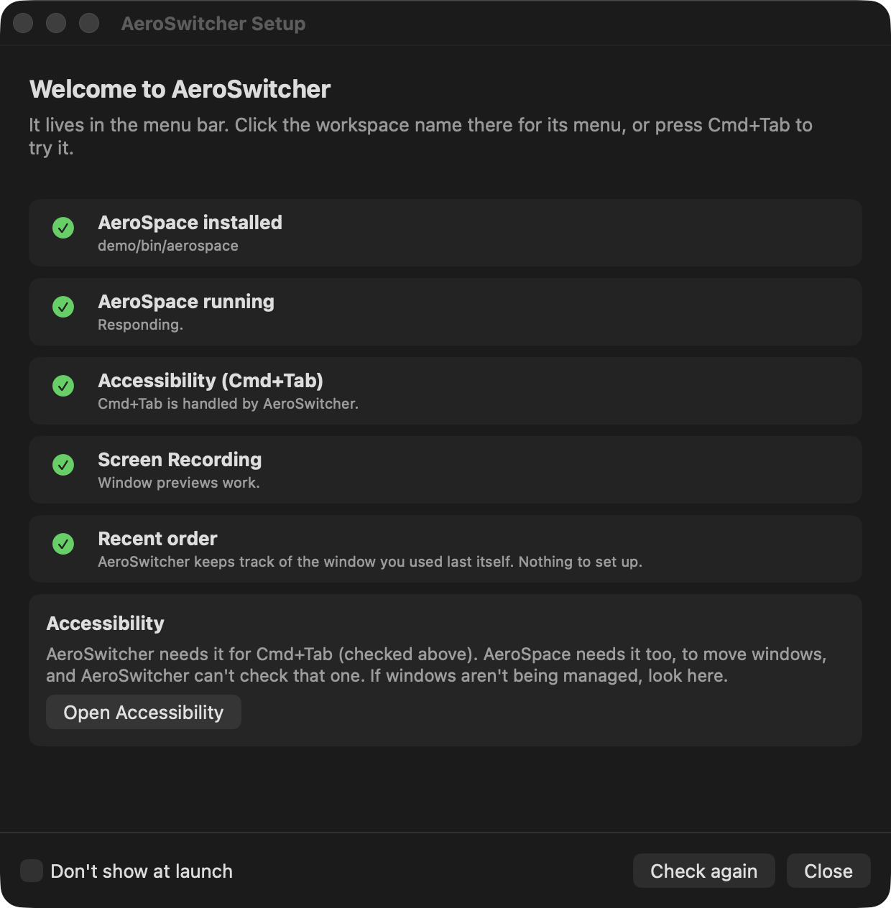
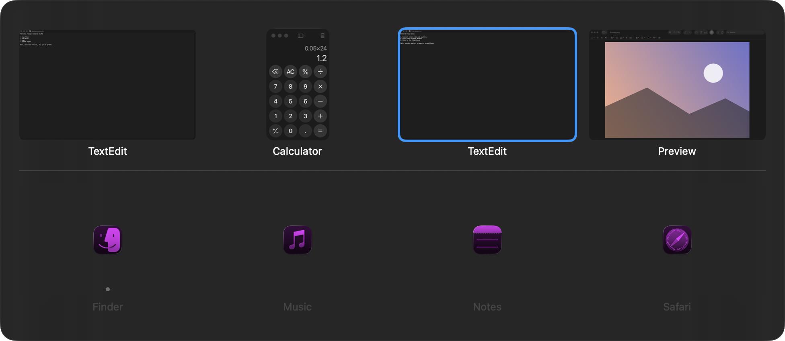

# Installing AeroSwitcher

AeroSwitcher is one app: workspaces, a window manager that shows one workspace at a time, and a Cmd+Tab that only shows that workspace. Nothing else needs to be installed. You need macOS 14 (Sonoma) or newer, on an Apple silicon or Intel Mac.

There are two ways to get it: download the ready-made app (part A), or build it yourself from the source code (part B). Both end with the same steps (part C).

## A. Download the app

1. Open the [latest release](https://github.com/remitoshniwal/aeroswitcher/releases/latest) and download the `AeroSwitcher-<version>.zip` file.
2. Double-click the zip in your Downloads folder. It unzips to **AeroSwitcher**.
3. Drag **AeroSwitcher** into your **Applications** folder. Launch at login only works from there.
4. Double-click it. macOS says it can't check AeroSwitcher for malicious software. That is because the app isn't signed by a paid Apple Developer account, not because something is wrong with it. Click **Done**. Don't click Move to Trash.
5. Open **System Settings > Privacy & Security**, scroll down to the message that AeroSwitcher was blocked, and click **Open Anyway**. Confirm with your password or Touch ID. macOS remembers this, so it's only needed once per version.

(The old trick of right-clicking the app and choosing **Open** no longer works for apps like this on recent macOS.)

Go on with part C.

## B. Build it yourself

**B1. Install Xcode Command Line Tools** (once). In Terminal:

```bash
xcode-select --install
```

**B2. Optional but recommended: create a code signing certificate** (once, before the first build).

Without it, `build.sh` signs the app ad hoc and prints a note saying so. The app works, but macOS treats every rebuild as a new app and asks for the permissions again each time. With a certificate in your Keychain, every build signed with it counts as the same app and keeps its permissions. If you'll only build once, skip this.

Open **Keychain Access** (Cmd+Space, type it):

1. Menu bar: **Keychain Access > Certificate Assistant > Create a Certificate...**
2. Name: `AeroSwitcherCodeSign` (exactly this, `build.sh` looks for this name)
3. Identity Type: **Self Signed Root**
4. Certificate Type: **Code Signing**
5. Click **Create**, then **Continue** through the rest, then **Done**.

**B3. Build it.**

```bash
git clone https://github.com/remitoshniwal/aeroswitcher.git
cd aeroswitcher
./build.sh
mv AeroSwitcher.app /Applications/
open /Applications/AeroSwitcher.app
```

`build.sh` compiles the app twice, once for Apple silicon and once for Intel, joins the two with `lipo`, wraps the result into `AeroSwitcher.app` and signs it. The first build takes a couple of minutes. If you only use one Mac, `ARCHS=arm64 ./build.sh` (Apple silicon) or `ARCHS=x86_64 ./build.sh` (Intel) builds just that half, quicker. If the build fails, the real error is printed right above the failure line.

An app you built yourself opens without the Open Anyway step from part A, because it never came from the internet.

## C. First launch

**C1. If you used AeroSpace before:** quit AeroSpace and remove it from **System Settings > General > Login Items**. Two window managers at once would fight over every window, so AeroSwitcher pauses while AeroSpace runs (the menu bar then shows a warning triangle). On its first launch AeroSwitcher copies your workspaces, their keys and your app rules from `~/.aerospace.toml`. It only reads that file and never changes it.

**C2. Grant two permissions.** AeroSwitcher opens its **Setup** window and shows what's missing, with a button for each. Both are in **System Settings > Privacy & Security**:

- **Accessibility**, so it can catch Cmd+Tab and the Option keys before macOS does, and move other apps' windows. Without it the window manager stays paused and Cmd+Tab opens the normal macOS switcher.
- **Screen Recording**, for the window pictures in the switcher. Without it the cards are blank.

If AeroSwitcher isn't in a list yet, click the **+** under the list, choose AeroSwitcher in Applications and switch it on. If it is in the list but still marked in Setup, select it, remove it with **-**, and add it again with **+**. Then click **Restart AeroSwitcher** in the Setup window; Screen Recording in particular often needs a restart.



The ticks update by themselves. Setup is always in the menu bar menu under **Permissions > Setup...**.

**C3. Try it.** You start with four workspaces: **Main**, **Work**, **Personal** and **Extra**, on **Option+1** to **Option+4** (or your AeroSpace ones). The menu bar shows the one you're in, and every window that was open is in it.

- Press **Option+2**. Your windows disappear and the menu bar says Work. Open an app: its window belongs to Work.
- Press **Option+1** to go back. Main's windows return exactly where they were.
- In a window, press **Option+Shift+2** to send it to Work.
- Press **Option+F** to flip a window between filling the screen and a smaller centered size.
- Hold **Cmd** and press **Tab**: only the windows of the workspace you're in.



**C4. Make the workspaces yours.** Menu bar menu > **Settings... > Workspaces**: rename workspaces, add more, record their keys by clicking the key chip, and send apps to a workspace with **+ App**. Right-click an app to move it to another workspace. The other tabs set up grey launcher tiles, the keys inside the switcher and custom icons. Every change applies at once.

**C5. Optional: start it at login.** Tick **Launch at login** in the menu bar menu (also in **Settings... > General**). Log out and back in once to check it starts by itself.

It runs with no Dock icon, only the workspace name in the menu bar.

## Updating

Quit AeroSwitcher from its menu (every hidden window comes back on screen first), replace the app in Applications with the new one, and open it again. Your settings are kept in `~/Library/Application Support/AeroSwitcher/`. A downloaded update may need the Open Anyway step again, and macOS may ask for the two permissions again; the Setup window shows it if so.

## Removing it

Quit AeroSwitcher from its menu so every window comes back on screen, then move it from Applications to the Trash. To remove its settings and log too, delete `~/Library/Application Support/AeroSwitcher` and `~/Library/Logs/AeroSwitcher`, and remove it from the Accessibility and Screen Recording lists.

## If something doesn't work

AeroSwitcher keeps a log of what it did and what failed: **Settings... > General > Show log**, or `~/Library/Logs/AeroSwitcher/AeroSwitcher.log`. The first lines say which version it is. Read through it before sharing it, it contains file paths.

- **A window is missing** → menu bar menu > **Bring Back All Windows**. Every window comes back on screen, in the workspace you're in.
- **Warning triangle in the menu bar** → the window manager is paused. The menu and the Setup window say why: no Accessibility permission, no workspaces, or AeroSpace running.
- **Cmd+Tab opens the normal macOS switcher** → Accessibility isn't switched on for AeroSwitcher (look at Input Monitoring too).
- **The switcher opens but the cards are blank** → Screen Recording isn't switched on, or needs a restart of AeroSwitcher.
- **Permissions are asked for again after every rebuild** → `build.sh` printed that it signed ad hoc: the certificate from step B2 is missing or has another name.
