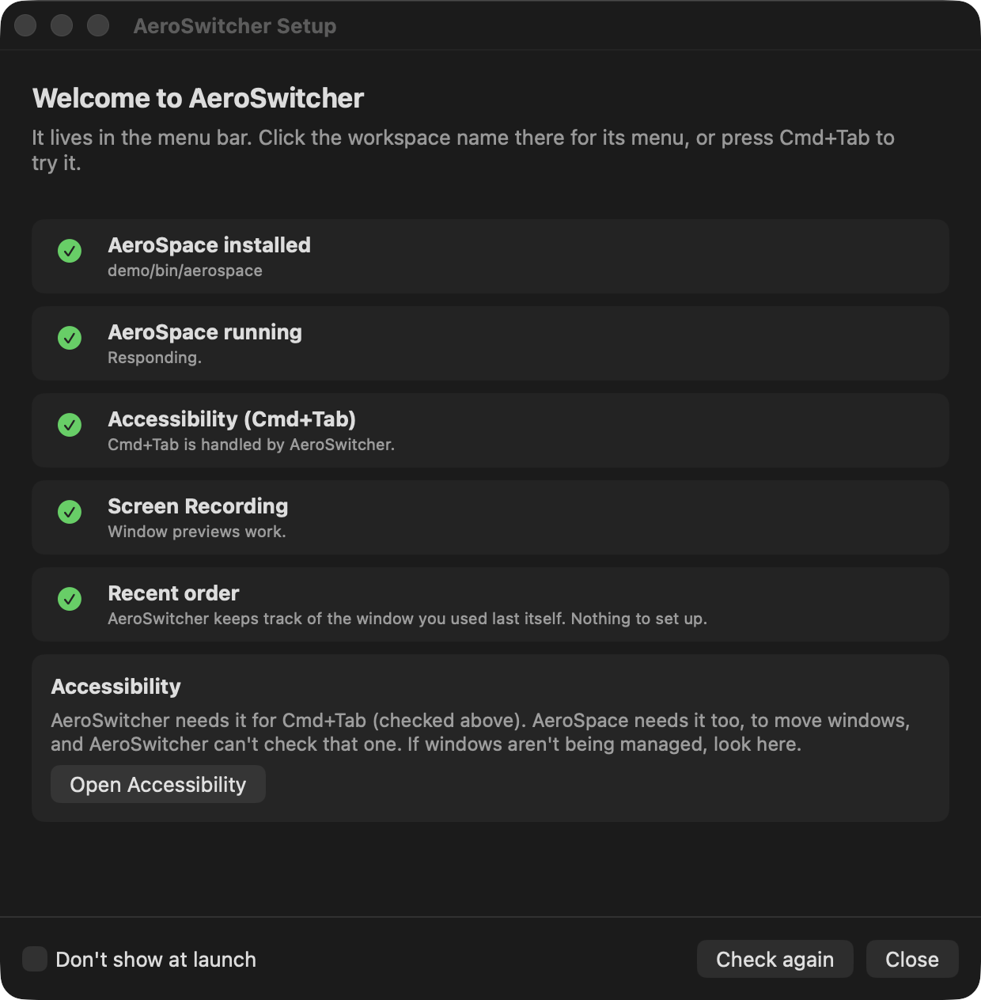
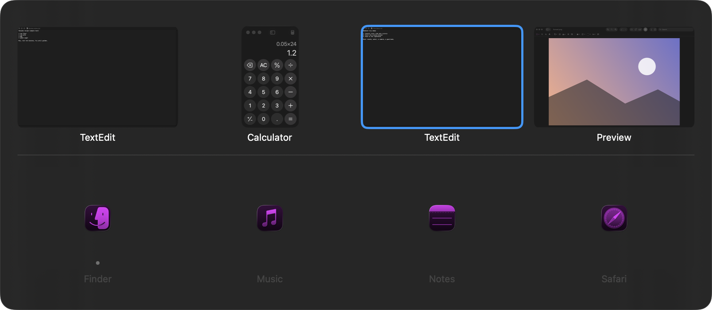

# Installing AeroSwitcher, from a blank Mac

This is a start-to-finish setup guide: nothing installed yet, ending with AeroSwitcher running quietly in the background every time you log in. If you already have Homebrew or AeroSpace, skip straight to whichever step you still need.

Do these roughly in order, each step depends on the one before it.

## 1. Install Homebrew

Homebrew is a package manager, basically an app store you run from Terminal, that both AeroSpace and a few build tools come through.

Check if you already have it:

```
brew --version
```

If that prints a version number, skip to step 2. If it says "command not found," open Terminal (Cmd+Space, type Terminal, Enter) and run:

```
/bin/bash -c "$(curl -fsSL https://raw.githubusercontent.com/Homebrew/install/HEAD/install.sh)"
```

This downloads and runs Homebrew's official installer. It'll ask for your Mac password partway through (needed to install into `/opt/homebrew`), that's normal. At the end, it usually prints two lines starting with `echo` and telling you to add Homebrew to your PATH, run exactly those lines if it shows them, then close and reopen Terminal.

Confirm it worked:

```
brew --version
```

## 2. Install AeroSpace

AeroSpace is the actual window manager, it does the tiling, workspaces, and window switching underneath. AeroSwitcher and the config talked about later are both just building on top of it, so this has to exist first.

```
brew install --cask nikitabobko/tap/aerospace
```

The first time you launch it (Applications folder, or `open -a AeroSpace` in Terminal), macOS will ask you to confirm you trust it, since it's not from the App Store. Approve it.

AeroSpace also needs **Accessibility** permission to move and resize windows at all, this is separate from AeroSwitcher's own permissions later. macOS should prompt for this the first time AeroSpace tries to do anything. If it doesn't prompt, add it manually:

**System Settings > Privacy & Security > Accessibility** → click the "+" button → find AeroSpace in Applications → enable its toggle.

## 3. Set up `~/.aerospace.toml`

This file is AeroSpace's own config, workspaces, keybindings, and (once you get to it below) the auto-maximize behavior all live here. AeroSpace looks for it at `~/.aerospace.toml` specifically, that's a fixed location, not something you can rename or move.

If you already have a working `.aerospace.toml` from this project, just put it there:

```
cp /path/to/your/.aerospace.toml ~/.aerospace.toml
```

(`~` is shorthand for your home folder, `/Users/yourname`.)

Restart AeroSpace after this (quit it fully and reopen, or `killall AeroSpace && open -a AeroSpace`) so it picks up the file for the first time. After that, `auto-reload-config = true` in the file means every future save applies instantly, no more restarts needed.

**Quick sanity check** it loaded correctly: press one of the workspace-switching keys from the config (`alt-q` in this setup). If your screen's active app changes or the menu bar workspace name changes, it worked.

## 4. Create the AeroSpace scripts folder

The fullscreen/maximize toggle (`alt-f` in the config) depends on three small script files living in a specific folder:

```
mkdir -p "$HOME/Library/Application Support/AeroSpace"
```

Then put these three files in it, exactly as named:

- `maximize.applescript`
- `restore.applescript`
- `toggle-maximize.sh`

If you're copying these from elsewhere, make sure `toggle-maximize.sh` is executable:

```
chmod +x "$HOME/Library/Application Support/AeroSpace/toggle-maximize.sh"
```

**Important**: `.aerospace.toml` finds this folder through `$HOME` (`"$HOME/Library/Application Support/AeroSpace"`) in several places. AeroSpace runs those commands with bash, which fills in your own home folder, so the file works under any user name. A plain `~` would not work there, because bash doesn't expand it inside quotes. The folder name has to stay exactly `AeroSpace`, under `Library/Application Support` in your home folder. If you put the scripts somewhere else, change the path in every place the file mentions it, otherwise the scripts silently won't be found. `grep "Application Support/AeroSpace" ~/.aerospace.toml` shows you every line.

## 5. Build AeroSwitcher

AeroSwitcher is the actual switcher app, the Cmd+Tab replacement. It's built from source, since it's a personal project and not something Apple's signed and notarized for wide distribution.

**5a. Optional but recommended: create a stable code-signing certificate (do this once, before your first build).**

You can skip this step. If `build.sh` finds no certificate named `AeroSwitcherCodeSign`, it signs the app ad hoc and prints a note saying so. The app works, but macOS counts every rebuild as a new app and asks for Input Monitoring and Screen Recording again each time. If you plan to build more than once, do this step.

Normally, every time you rebuild a Swift app, macOS treats the new build as a completely different, unrecognized app and resets any permissions you'd already granted it (Input Monitoring, Screen Recording), forcing you to re-approve them every single time. A self-signed certificate in your own Mac's Keychain sidesteps this: as long as you keep signing new builds with the *same* certificate, macOS keeps treating them as "the same app" and permissions survive rebuilds.

Open **Keychain Access** (Cmd+Space, type it):

1. Menu bar: **Keychain Access > Certificate Assistant > Create a Certificate...**
2. Name: `AeroSwitcherCodeSign` (must match exactly, `build.sh` refers to this name)
3. Identity Type: **Self Signed Root**
4. Certificate Type: **Code Signing**
5. Click **Create**, then **Continue** through the rest, then **Done**.

You only need to do this once ever, not once per rebuild.

**5b. Lay out the project folder.**

Swift Package Manager (the build system used here) expects a specific folder structure:

```
AeroSwitcher/
├── Package.swift
├── Info.plist
├── AppIcon.icns
├── build.sh
└── Sources/
    └── AeroSwitcher/
        ├── main.swift
        ├── Logging.swift
        ├── AeroSpaceBridge.swift
        ├── ThumbnailCapture.swift
        ├── DataModel.swift
        ├── Config.swift
        ├── Views.swift
        ├── MRUTracking.swift
        ├── WindowController.swift
        ├── Keybinds.swift
        ├── HotkeyInterception.swift
        ├── MenuBar.swift
        ├── SettingsWindow.swift
        └── SetupHelp.swift
```

The `.swift` files specifically have to sit inside `Sources/AeroSwitcher/`, not next to `Package.swift`, that's just how Swift Package Manager finds source files (the `path:` line inside `Package.swift` points there). Every `.swift` file in that folder gets built into the app automatically, there's no list of them to keep up to date.

**5c. Build it.**

From Terminal, inside that `AeroSwitcher` folder:

```
cd path/to/AeroSwitcher
chmod +x build.sh
./build.sh
```

This compiles the Swift code twice, once for Apple silicon Macs and once for Intel Macs (`swift build -c release`), joins the two into one program with `lipo`, wraps the result into a real `.app` bundle with the right `Info.plist`, and signs it (with the certificate from step 5a if you made one, otherwise ad hoc, and it tells you). If it finishes with `Done. Built: AeroSwitcher.app`, you now have a working app sitting right there in that folder.

The first build takes a couple of minutes because of the two compiles, later ones are quicker. If you only ever use this one Mac, `ARCHS=arm64 ./build.sh` (Apple silicon) or `ARCHS=x86_64 ./build.sh` (Intel) builds just your half.

If it fails instead, the error is almost always a plain Swift compile error (typo, missing brace) printed right above the failure, read it before assuming something bigger is wrong.

## 6. Move it to Applications and grant permissions

```
mv AeroSwitcher.app /Applications/
```

`/Applications` is the standard, expected location, Login Items and Spotlight both expect apps to live there.

Open it once (double-click, or `open /Applications/AeroSwitcher.app`). Since it's self-signed rather than from a paid Apple Developer account, macOS will likely warn you it can't verify the developer the very first time. Right-click the app > **Open** > **Open** again in the dialog gets past that (only needed once).

Then grant its two permissions, both under **System Settings > Privacy & Security**:

- **Input Monitoring** — needed for it to see Cmd+Tab being pressed at all. Without this, pressing Cmd+Tab does nothing.
- **Screen Recording** — needed to take the window thumbnails. Without this, the switcher opens but every tile is blank.

If AeroSwitcher isn't listed under either yet, open it once first (it registers itself the moment it tries to use the permission), then check again.



You don't have to remember any of this: if a permission, AeroSpace itself, or the recent-order line in `.aerospace.toml` (step 3) is missing, AeroSwitcher opens its **Setup** window on launch, says what is missing and has a button for each fix. It's also in the menu bar menu under **Permissions > Setup...**. Ticks appear by themselves once you've fixed something. Screen Recording sometimes only takes effect after a restart, the window has a button for that.

**Test it now**, before moving on: hold Cmd and press Tab. You should see a row of window thumbnails for whatever's open in your current AeroSpace workspace.



## 7. Set up the config file

AeroSwitcher creates `~/Library/Application Support/AeroSwitcher/config.json` automatically the first time it runs, with sensible defaults and an empty `workspaces` list. You don't have to touch it for the app to work, Cmd+Tab and the Cmd+` overview both work immediately.

If you want the greyed-out "not open yet" launcher tiles (jump straight to launching an app that isn't running), click AeroSwitcher's workspace name in the menu bar, choose **Settings...**, open **Launcher tiles**, pick a workspace and click **Add app...**, matching your `.aerospace.toml` groupings. You can also edit the file by hand and add entries under `workspaces`; see the **Config file** section of the main documentation for the exact format, this part is optional and can be done any time later, not something that blocks getting the app running.

Changes in the settings window apply at once, and saving `config.json` by hand applies it within a second, no restart needed (see **Reloading** in the main documentation).

## 8. The last permission: Accessibility, for the maximize toggle

Separately from AeroSwitcher's own two permissions above, the fullscreen/maximize system set up in step 4 needs its own **Accessibility** permission, since it resizes windows via AppleScript's System Events. This is usually already covered by granting AeroSpace Accessibility access back in step 2 (since AeroSpace is what actually launches the scripts), but if windows stop resizing when you press `alt-f` or open a new app, this is the first thing to check:

**System Settings > Privacy & Security > Accessibility** — confirm AeroSpace (and/or `osascript`, if it shows up as its own separate entry) is listed and enabled.

## 9. Run AeroSwitcher automatically at login

You can do this whenever you like. Rebuilding later is fine too: the permissions survive a rebuild as long as it's signed with the same certificate from step 5a.

Open `/Applications/AeroSwitcher.app`, click its workspace name in the menu bar, and tick **Launch at login** (also in **Settings...** > General). (It only allows this from an Applications folder, because macOS remembers where the app was.) Adding it by hand in **System Settings > General > Login Items & Extensions** under "Open at Login" works too; the menu then shows it ticked.

That's it, no separate background service needed. It runs with no Dock icon (this is intentional, set via `LSUIElement` in its `Info.plist`) and nothing on screen except its menu bar item until you press Cmd+Tab.

**One icon instead of two:** AeroSwitcher's menu bar item does everything AeroSpace's icon does that you'd use day to day. To hide AeroSpace's icon, tick **Hide AeroSpace's icon** in AeroSwitcher's menu and follow the short instructions (AeroSpace's name has to be on the left of the │ that appears, then click Hide). Don't switch AeroSpace off in **System Settings > Menu Bar > Allow in the Menu Bar** and don't Cmd-drag its icon out of the bar: AeroSpace quits when you do either.

Log out and back in once (or restart) to confirm it actually launches on its own before you stop thinking about it.

---

## Using it day to day

- **Cmd+Tab** — opens the switcher, scoped to whatever AeroSpace workspace you're currently on. Keep holding Cmd and press Tab again to move to the next window, release Cmd to switch to whatever's selected.
- **Cmd+Shift+Tab** — same, but opens landing on your least-recently-used window (matches how stock macOS Cmd+Tab behaves).
- **Cmd+\`** (backtick, top-left key) — opens a second, read-only panel showing every window across every workspace at once, for when you just want to glance at everything open. Nothing in this panel is clickable, it's purely for looking.
- While the switcher is open: **D**/**A** cycle forward/back through windows, **S**/**W** step onto and off of the greyed "not open yet" row, **Q**/**E** page up/down, **F** confirms (same as releasing Cmd), **Escape** cancels. All of these are under your left hand, next to where Cmd already is.
- **Alt+Q/W/E/A/S/D** — jump directly to a workspace (Core / School / Personal / Creative / Dev / Gaming).
- **Alt+Shift+Q/W/E/A/S/D** — send the window you're currently on to a workspace.
- **Alt+F** — toggles the current window between filling the screen and a smaller, centered size. New windows start maximized automatically, you only need this when you actually want something smaller.

Everything above is a keybinding default. Both AeroSwitcher's own keys (`config.json`) and AeroSpace's own keys (`.aerospace.toml`) can be changed, see the **Keybindings** and **Config file** sections of the main documentation for how.

## Keeping the repo's AeroSpace copies up to date

The `aerospace/` folder in this repo holds copies of `~/.aerospace.toml` and the three scripts, not the live files. After you edit the real ones, run this from the repo folder to copy them in:

```
./sync-aerospace.sh
```

It only copies from your Mac into the repo, never the other way, so it can't break your running setup. It prints which files changed, and `git diff aerospace/` shows the exact lines. Commit them if they look right. If a live file is missing it skips that file instead of blanking out the repo copy, and while copying it writes `$HOME` in place of your home folder path, so the copies in the repo never contain your user name.

At the end it also runs a **drift check** (`check-drift.js`), which compares `~/.aerospace.toml` with AeroSwitcher's `config.json` and lists apps that are set up in one but not the other, or in a different workspace in each. It only prints, it never changes either file. Some differences are on purpose (Finder is a launcher tile everywhere but has no AeroSpace rule), so put those in the `EXCEPTIONS` list at the top of `check-drift.js` and they stop being reported. You can also run it on its own:

```
osascript -l JavaScript check-drift.js
```

Matching app names between the two files is loose (the toml says "Ableton Live", config.json says "Ableton"), so an odd false alarm is possible. If it reports something that's clearly wrong, that matching is the place to look.

## If something doesn't work

AeroSwitcher keeps a log of what it did and what failed: **Settings... > General > Show log**, or `~/Library/Logs/AeroSwitcher/AeroSwitcher.log`. The first lines say which version it is. Read through it before sharing it, it contains file paths.

- **Cmd+Tab does nothing** → check Input Monitoring permission is granted to AeroSwitcher.
- **Switcher opens but thumbnails are blank** → check Screen Recording permission is granted to AeroSwitcher.
- **New windows don't move to the right workspace, or don't fill the screen** → check AeroSpace is actually running, and that `~/.aerospace.toml` loaded without errors (run `aerospace list-workspaces --all` in Terminal, if that errors, your config has a syntax problem).
- **Alt+F does nothing, or windows don't resize** → check Accessibility permission (step 8), and double check the folder path inside `.aerospace.toml` matches where you actually put the three script files (step 4).
- **Permissions keep resetting on every rebuild** → you likely skipped step 5a (the stable Keychain certificate). `build.sh` says "signed ad hoc" when it can't find the certificate, so look for that note in its output, and check the certificate is named exactly `AeroSwitcherCodeSign` in Keychain Access.
